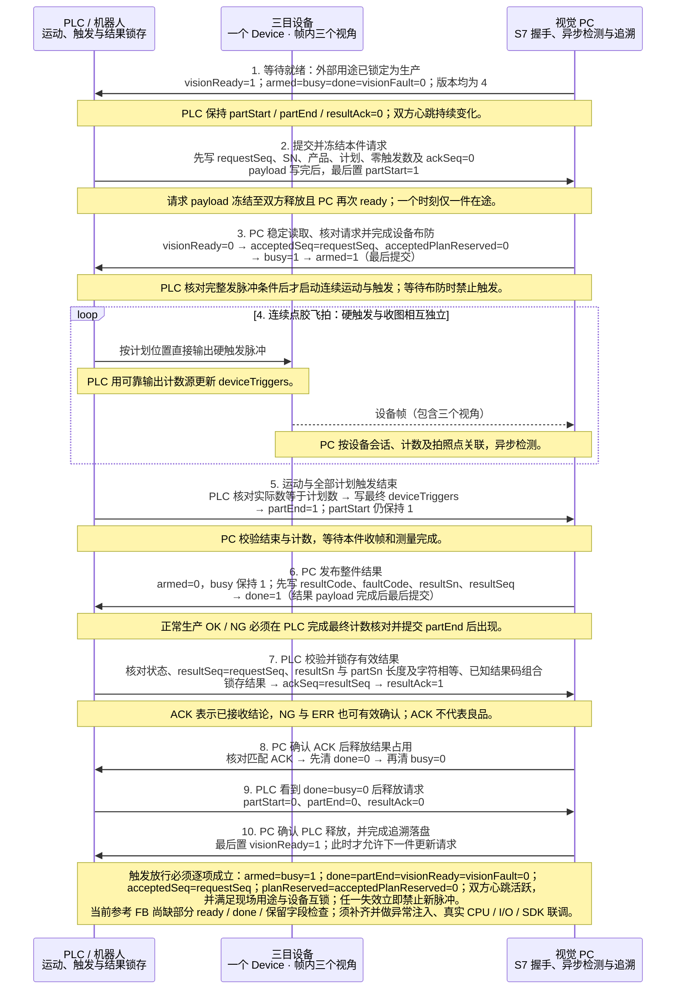
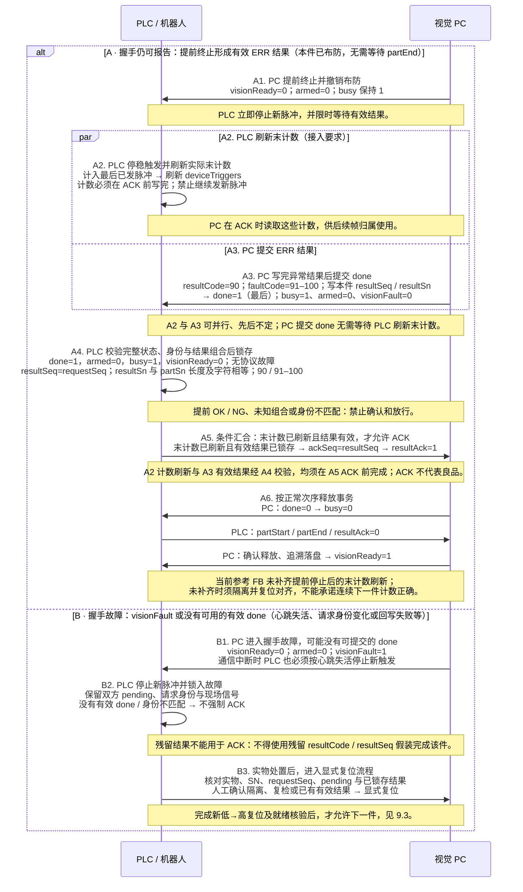
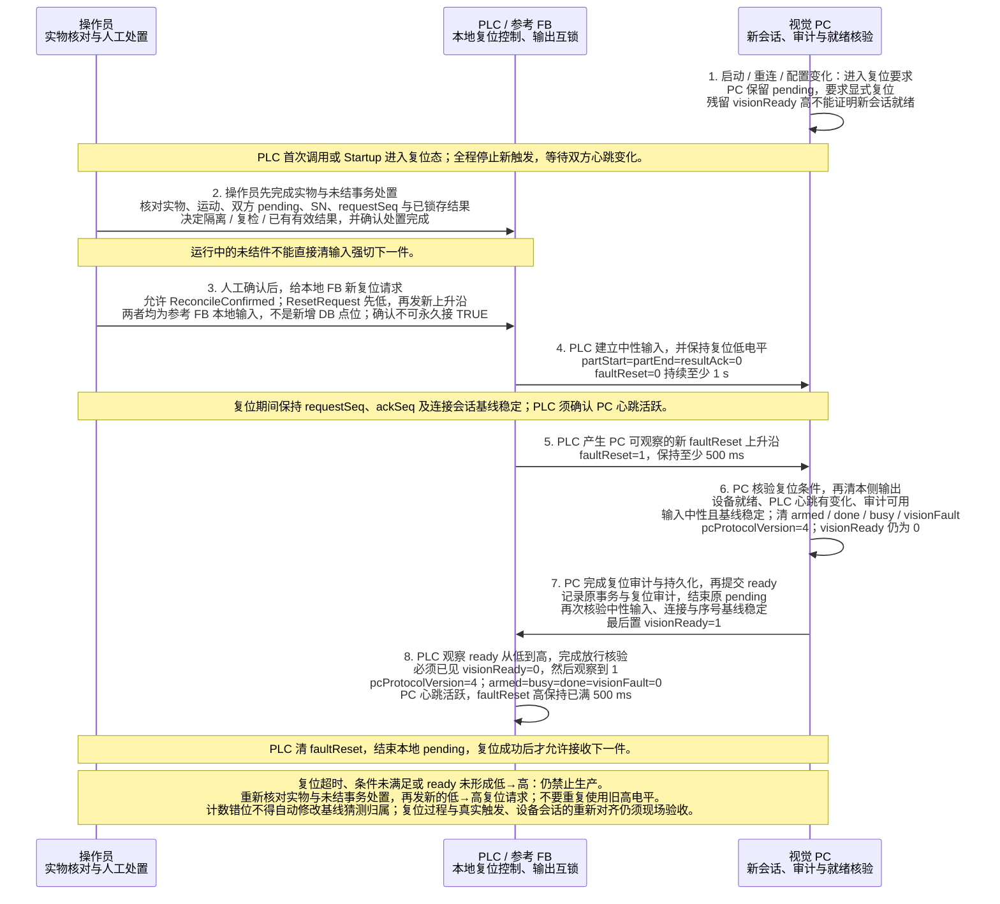

# GlueSight PLC 通讯协议

文档修订：2.0；审核日期：2026-10-19；线上握手协议版本：4。

适用于 GlueSight 一期连续点胶飞拍的 PLC 与视觉工控机对接。PLC 负责机器人运动和位置同步硬触发，PC 负责接件、相机布防、收图、检测及整件结果回传。一件只有一个在途事务，完成结果确认和双方释放后才能开始下一件。

**设备数量固定为一台 SDK 三目相机设备。** 全文统一称“设备通道 1”，图 1、图 2、图 3 是该设备帧内的视角。点表只保留唯一设备的 `deviceShots` 与 `deviceTriggers`，直接删除额外设备通道。协议不接受旧多通道点表或计划，须重新生成点表并重新导出计划。

**协议版本 4 按《涂胶检测通信交互表 20261018 V1.0》调整，与协议 3 布局不兼容。** PLC 为西门子 S7-200 SMART，共享区为 V 区（S7 协议中的 DB1，原默认 DB100）；序号、计划版本与保留字段由 UDInt 改为 DInt；`partSn` 迁至 DBB160、`resultSn` 迁至 DBB100，均为最大 50 字符的字符串；`protocolVersion`/`pcProtocolVersion` 由 3 升为 4。旧点表（DB100、`STRING[24]`、UDInt）和旧 PLC 程序（`protocolVersion` 不为 4）直接被 PC 拒绝，不做兼容读取；须按协议 4 模板重新生成点表。与交互表的逐项差异见第 12 节，取舍理由与待 PLC 确认的问题见 [交互表适配决策](../decisions/plc-table.md)。

**同一 DB 也承载示教整圈采集，线上没有生产/采集模式字段。采集成功同样返回 `1/0`，只表示采集完成，不表示产品合格。** PLC 必须在外部维护并锁定本次用途，示教期间禁止生产自动发件和良品放行；不能仅凭 ready 或 resultCode=1 判断生产模式。示教执行条件和当前限制见第 4.1 节。

本协议以仓库 S7 模板和双方握手实现为依据。PLC SCL 为 S7-1200/1500 接入参考和 S7-200 SMART 的逻辑参考（200 SMART 不支持 SCL），仍需现场编程、真实 CPU、触发线路与相机联调验收。实现说明见 [S7 握手契约与现场接入](plc-s7-phase1.md)。

## 1 通讯参数与分工

| 项目 | 约定 |
| --- | --- |
| 连接方式 | PC 作为 S7 ISO-on-TCP 客户端，读写 PLC 共享区 |
| PLC | 西门子 S7-200 SMART（交互表 V1.0）；具体型号与固件现场确认 |
| PLC IP / 端口 | 默认 192.168.2.10 / 102；工控机连接 PLC 的网口须在同一网段 |
| 连接参数 | 本地 / 远端 TSAP 0x0102 / 0x0201（OP 连接，不占用 Micro/WIN SMART 的 PG 编程连接），PDU 240；连接被拒时按 [适配决策第 2 条](../decisions/plc-table.md#2-s7-200-smart-连接参数) 核对 |
| 共享区 | 200 SMART 的 V 区，S7 协议中按 DB1 访问（`DB1.DBW2` 即 VW2）；S7-1200/1500 接入时为关闭优化块访问的标准 DB，可改号 |
| 区域长度 | 至少使用到 VB210；SN 采用 S7 STRING 时至少到 VB211 |
| 数值字节序 | 大端 ABCD；WORD 为 16 位无符号（0–65535）；DInt 为 32 位有符号，本协议只使用 0–2147483647，负数一律拒绝 |
| 字符串 | 工件 SN 最大 50 字符，默认 200 SMART 字符串（首字节为实际长度），可选 S7 `STRING[50]`，见第 2.1 节 |
| PC 轮询周期 | 一期 S7 模板默认 50 ms；每次分两段读取字节 0–37 与 64–210（S7 STRING 为 64–211） |
| 心跳 | 双方默认每 500 ms 翻转一次；观察变化，3 s 不变化判失活 |
| 自动连接 | 一期模板默认关闭；连接成功后仍必须显式复位 |
| 写入所有权 | PLC 只写字节 0–63 与 160–210（S7 STRING 为 160–211）；PC 只写字节 64–150（S7 STRING 为 64–151） |

PLC 区在 PC 点表中必须设为只读，PC 区设为读写。禁止整区清零（含 `FILL_N` 块填充）或块复制覆盖对方区域；同一字节不能由双方分别写不同 bit。PC 的 50 ms 轮询不承担拍照位置或曝光时刻控制。

现场触发程序须同时满足 `TriggerPermit=1` 和第 5 节的完整发脉冲条件。该信号是参考 FB 的本地输出，不是共享区点位；当前参考程序的放行表达式缺少部分保护，见第 5 节接入限制。实际输出接线、脉冲宽度、极性和运动停止策略由 PLC/机器人程序负责。S7-200 SMART 不支持 SCL，参考 FB 只作逻辑参考，须在 Micro/WIN SMART 中按本协议实现同等状态机。

## 2 PLC 写入 PC 读取点表

以下地址按 DB1（即 200 SMART 的 V 区）。标签名称区分大小写，PC 严格握手要求每个标签只配置一次。

| 地址 | 类型 | 标签 | 含义及要求 |
| --- | --- | --- | --- |
| DB1.DBX0.0 | Bool | `partStart` | 请求提交标志；payload 写完后最后置 1，保持至结果释放 |
| DB1.DBX0.1 | Bool | `partEnd` | 本件运动及全部计划触发结束；最终计数写完后置 1 |
| DB1.DBX0.2 | Bool | `resultAck` | 结果确认标志；锁存有效结果并写 ackSeq 后置 1 |
| DB1.DBX0.3 | Bool | `faultReset` | 明确复位请求；必须先观察低电平，再有新上升沿 |
| DB1.DBX0.4 | Bool | `plcHeartbeat` | PLC 心跳，每 500 ms 翻转 |
| DB1.DBW2 | WORD | `protocolVersion` | 固定 4；2、3 及其他值拒绝 |
| DB1.DBD4 | DInt | `requestSeq` | 本件事务序号，1–2147483647，非零且递增 |
| DB1.DBW12 | WORD | `productCode` | 生产配方产品代码；PC 手动选配方时也必须匹配。示教采集不据此选择候选 |
| DB1.DBW14 | WORD | `shotCount` | 协议总数为 1–65535；示教采集接受 PLC 提供的 1–64 |
| DB1.DBD16 | DInt | `planVersion` | 生产使用 PC 分配并导出的计划版本；示教见第 4.1 节，均不得为 0 或负数 |
| DB1.DBD20 | DInt | `planReserved` | 固定 0，非零拒绝处理 |
| DB1.DBW24 | WORD | `deviceShots` | 设备通道 1 计划触发数，等于 shotCount |
| DB1.DBD32 | DInt | `ackSeq` | 确认时回显本件 resultSeq，新件开始前清为 0 |
| DB1.DBW36 | WORD | `deviceTriggers` | 设备通道 1 本件已发脉冲数，布防前为 0，结束时等于 deviceShots |
| DB1.DBB160.50 | 字符串（50） | `partSn` | 工件 SN 字符串，从 DBB160 起；不替代事务序号，规则见第 2.1 节 |

PLC 区保留空间：DBX0.5–0.7、DBB1、DBB8–11（协议 2 的数值 SN 位置）、DBB26–31、DBB38–63（协议 3 的 `partSn` 位置，交互表列出其中 DBB38–41）。保留字节保持 0，不定义设备通道或计数字段，不新增跨方向写入字段。

## 3 PC 写入 PLC 读取点表

| 地址 | 类型 | 标签 | 含义及要求 |
| --- | --- | --- | --- |
| DB1.DBX64.0 | Bool | `visionReady` | 可以接收下一件；连接成功不等于就绪 |
| DB1.DBX64.1 | Bool | `armed` | 本件相机布防完成，必须结合 acceptedSeq 判断 |
| DB1.DBX64.2 | Bool | `busy` | 事务处理中，包含等待结果确认阶段 |
| DB1.DBX64.3 | Bool | `done` | 结果有效；PC 写完结果 payload 后最后置 1 |
| DB1.DBX64.4 | Bool | `visionFault` | 协议或设备故障，停止新触发并处置 |
| DB1.DBX64.5 | Bool | `pcHeartbeat` | PC 通讯心跳，默认每 500 ms 翻转 |
| DB1.DBW66 | WORD | `pcProtocolVersion` | 成功复位后为 4 |
| DB1.DBD68 | DInt | `resultSeq` | 本件结果事务序号，应等于 requestSeq |
| DB1.DBW76 | WORD | `resultCode` | 生产整件结果或示教采集完成码，须结合外部锁定的用途，见第 6 节（交互表误写为 DBD76） |
| DB1.DBW78 | WORD | `faultCode` | 检测异常码，正常质量结果为 0（交互表误写为 DBD78） |
| DB1.DBD80 | DInt | `acceptedSeq` | 已接受并布防的 requestSeq |
| DB1.DBD84 | DInt | `acceptedPlanReserved` | 布防时写 0，核对接受状态时应为 0 |
| DB1.DBB100.50 | 字符串（50） | `resultSn` | 本件结果 SN，与 partSn 同格式，实际长度与字符须相等 |

PC 区保留空间：DBX64.6–64.7、DBB65、DBB72–75（协议 3 前的数值 `resultSn` 位置）、DBB88–99、DBB152–159。PLC 不写此区域。`done=0` 时结果字段可能保留上件数值，不能作为新件结论。

### 2.1 工件 SN 字符串

`partSn`（`DB1.DBB160.50`）与 `resultSn`（`DB1.DBB100.50`）最大 50 字符，支持两种编码，两段必须相同，PC 校验点表时拒绝混用：

| 编码 | 点位类型 | `partSn` 占用 | `resultSn` 占用 | 字节布局 |
| --- | --- | --- | --- | --- |
| 200 SMART 字符串（默认） | `smartString` | DBB160–210 | DBB100–150 | +0 实际长度 0–50；+1 起为字符；未用字节补 0 |
| S7 `STRING[50]` | `string` | DBB160–211 | DBB100–151 | +0 声明最大长度 50（0x32）；+1 实际长度 0–50；+2 起为字符；未用字节补 0 |

200 SMART 字符串与 `STR_CPY`、`S==` 等 200 SMART 字符串指令格式一致，是 S7-200 SMART 的默认选择；PLC 若按 `STRING[50]` 自行维护两个头字节，在 PLC 页“载入一期 S7 点表”中把“工件 SN 字符串格式”改为 S7 STRING。编码选错时 PC 读到的长度字节或字符不合规，按点位读错误或不合规 SN 进入视觉故障，不会把错误内容当作有效 SN。

**长度字节异常不是请求 payload 不合法。** PC 每个轮询周期都读取两段 SN：实际长度大于 50，或 S7 STRING 的声明长度字节不为 50 时，该点位读错误，与心跳、序号等字段读失败一样直接进入视觉故障（`visionFault=1`、`visionReady=0`），与是否有 `partStart` 无关。200 SMART 字符串没有声明长度字节，整区清零后读为空串，空闲时不报错，提交请求时按不合规 SN 处理。S7 STRING 两段的恢复责任按所有者划分：

- `resultSn`（PC 区）仅声明长度字节不为 50 时，PC 在显式复位中自行恢复：满足第 8 节复位条件后，PC 先把 `resultSn` 写回空串（头 `32 00`），读回确认并记入复位审计，再继续清输出、置 `visionReady`。实际长度大于 50 等其他读错误不在此列，仍须 PLC 恢复。
- `partSn`（PLC 区）长度头异常时 PC 不写该区，显式复位无法完成；必须由 PLC 恢复起始值（按 `32 00` 写回头字节），再按第 8 节复位。

PC 的自恢复只是兜底，不改变 PLC 职责：禁止整区清零。

SN 规则：

- 长度 1–50 个字符，每个字符为 ASCII 可打印字符 0x20–0x7E；去掉首尾空白后不能为空。
- SN 原样保存与回显，PC 不做 trim 或大小写变换。PLC 侧要求 `resultSn` 与 `partSn` 的实际长度及每个字符相等（S7 STRING 另含声明长度）；PC 写入时未用字节补 0，PLC 比较时不要依赖 `partSn` 的未用字节，建议用 `S==` 比较整个字符串。
- SN 不替代 `requestSeq`；同一 SN 复检仍须新的 `requestSeq`。
- 离线产线（仿真）为每件分配形如 `OFFLINE-0001234567`（`OFFLINE-` 加 10 位数字）的 SN，同一离线运行内唯一，样本件按 SN 字符串认领。

长度字节正常但内容不合规的 `partSn`（实际长度为 0、含 0x20–0x7E 以外字符、去掉首尾空白后为空）在 PC 读取请求时判定，与其他请求 payload 不合法完全同样处理，见第 5 节。

## 4 拍照计划与三目设备

PC 从已保存生产配方导出计划，PLC 工程师将产品代码、计划版本、拍照顺序、Pose 与实际触发输出建立对应表。当前导出 JSON 不包含 `productCode`、运动坐标或物理输出地址；产品代码从配方另外核对，运动路径由机器人/PLC 配置。

必须满足：

- `protocolVersion=pcProtocolVersion=4`。
- `deviceShots=shotCount`，总数非零。
- `planVersion`、总数及设备计划触发数与 PC 当前计划一致。
- PC 只配置一台设备，导出计划的 `deviceId` 必须对应此设备；所有拍照点的 `cameraId` 都指向该设备。
- 请求 payload 从 `partStart=1` 起冻结，保持至本件 start/end/ACK 已清且 PC 再次 ready；下一件仅在 ready 后更新。期间只更新触发计数、结束位和 ACK。

唯一三目设备按“一个 Device、一次触发一个设备帧、帧内三个视角”建模，固定使用设备通道 1。检测选择一个或多个视角均不增加 PLC 触发数。例如四个拍照点分别选择视角 1、2、3、1，仍是 `shotCount=deviceShots=4`，整件结束时 `deviceTriggers=4`。当前海康路径已能按明确配置的横向三等分、纵向三等分或三个矩形区域拆分单张拼接图；未配置布局拒绝启用，布局/尺寸不符产生图像错误。此软件路径不证明现场 SDK 一定如此交付，真实原图、视角顺序、计数来源和触发线路仍须联调验收。

`shotId` 标识拍照点且必须唯一；`poseId` 标识现场位置，可被多个拍照点引用；`cameraId` 标识设备；`view` 标识帧内视角，由 PC 配方管理，当前 PLC 计划 JSON 的 shots 不携带 view。

计划版本由 PC 配方库分配，不手工猜测或复用。改变产品代码、拍照点顺序、ID、Pose 或设备绑定会分配新版本；只改检测限值、检测参数、示教中线、不检设置或视角选择沿用原版本。更换设备或改变设备配置必须暂停接件，核对拍照点绑定，重新导出并人工评审设备与现场触发输出的对应关系，完成复位后再生产。拍照计划不使用内容哈希匹配；旧 `planHash`、`acceptedPlanHash` 标签直接拒绝，须按新模板重建点表，DBD20/84 固定为零值保留字段。

### 4.1 示教整圈采集

1. 现场先切到示教用途并关闭自动生产请求与良品放行。确认双方上一事务已释放，PC 空闲后，由操作员在 PC 为候选草稿启动采集，使用唯一已就绪的三视角设备，PC 不手填触发数量；真实设备要求 Line0 硬触发。PC 等待开始后，PLC 才能提交新 requestSeq，仍按第 5 节等待 armed。
2. PLC 在开始请求中提供 `shotCount=deviceShots`，范围 1–64；PC 接受时锁存该数量，并按有效收图生成拍照点。结束时 `deviceTriggers`、实际接收数和完整保存帧数必须都等于该计划数量。每次触发必须交付完整三幅图，不能将三个视角计成三次拍照。
3. 当前采集路径从 PLC 请求记录非零 `planVersion`，按数量生成采集序列，不与已发布生产计划比较；`productCode` 不参与候选匹配，候选来自 PC 操作员选择。因此现场须事先核对候选、唯一设备、数量、运动路径及版本并留记录；收到 armed 不证明这些业务身份已被 PC 在线核验。采集成功也不会自动发布生产配方，之后仍需示教、验证、发布并重新导出生产计划。
4. 正常收尾：PLC 写最终计数、置 partEnd，PC 等完整采集收尾窗口结束并确认收图与保存完成后，提交 `resultCode=1/faultCode=0`。该值仅为采集完成，需锁存、ACK、释放，不计入生产 OK/NG。采集接收失败、超时或操作员中止，在握手仍可报告时返回 `90/94`；采集布防失败、计数边界或通信故障可能直接进入 visionFault，没有 done。
5. 失败轮次不能继续补拍。处置未结事务并复位；PC 对失败的设备会话禁止再次采集，需重连该设备后整圈重采。正常完成或失败都会结束 PC 的采集占用，后续 start 可能转入生产路径；PLC 必须保持外部示教互锁，逐轮重新在 PC 启动采集。完成释放、确认 PC 无活动采集并核对生产配方/计划后，才可解除示教互锁。

**当前模式互锁缺口：** DB 和参考 FB 均没有模式确认；PC 按收到 start 时是否存在活动采集轮次分流。PC 等待开始超时或操作员取消后，迟到的 start 可能按生产请求处理。上述人工流程不能消除此竞态；现场自动示教接入前需补齐可验证的双方模式互锁，期间不得把采集完成码接到良品放行。

## 5 单件握手流程

| 阶段 | PLC 动作 | PC 动作与放行条件 |
| --- | --- | --- |
| 等待就绪 | 保持 start/end/ACK 为 0，确认心跳活跃 | `visionReady=1`，`armed/busy/done/visionFault=0`，协议版本为 4 |
| 提交请求 | 递增 requestSeq；写 SN（字符串）、产品代码、计划和零触发数，最后置 partStart | 稳定读取请求，核对 SN 格式、身份、配方、设备及计划 |
| 等待布防 | 保持请求，禁止发触发 | 先撤 ready，写 acceptedSeq 和零保留位，置 busy，最后置 armed |
| 连续运动与触发 | 核对布防条件后，按计划向唯一设备发硬脉冲并更新 deviceTriggers | 收图并按设备会话、触发计数和拍照点关联，异步检测 |
| 提交结束 | 核对实际数等于计划数，写最终计数，再置 partEnd；start 仍为 1 | 核对结束与计数，等待本件收帧及测量完成 |
| 发布结果 | 等待 done，不抢先 ACK | 撤 armed，保持 busy，写结果码、异常码、SN、序号，最后置 done |
| 确认结果 | 核对并锁存结果，写 ackSeq，再置 resultAck | 核对匹配 ACK 后，先清 done，再清 busy |
| 双方释放 | 看到 done=busy=0 后，清 start/end/ACK | 确认 PLC 已释放并完成追溯落盘，再置 ready |

**请求 payload 不合法：** `requestSeq=0`、`planReserved≠0`、`deviceShots≠shotCount`、协议版本不符，以及 `partSn` 不合规（见第 2.1 节），均按同一方式处理：PC 不布防、不生成结果、不写 `resultCode`，进入视觉故障（`visionFault=1`、`visionReady=0`），没有可提交的 done。PLC 须释放 `partStart`，并执行故障复位（`faultReset` 上升沿，见第 8 节）后重新开始，不能等待 armed 或结果。

**发脉冲的必要条件：** `armed=1`、`busy=1`、`done=0`、`partEnd=0`、`visionReady=0`、`visionFault=0`、`acceptedSeq=requestSeq`、`planReserved=acceptedPlanReserved=0`，双方心跳活跃且现场用途、设备互锁满足。任一条件失效立即禁止新脉冲。

**参考程序接入限制：** 当前 SCL 的 `AcceptedMatches` 仅核对序号，`TriggerPermit` 未完整检查 ready、done 和两处零值保留字段；PC 对非零保留字段的轮询故障不能替代 PLC 本扫描的输出互锁。现场接入须补齐上述检查并验证异常注入，不能将现有 FB 直接视为已实现完整条件。

已发脉冲数必须来自可靠输出计数源；普通扫描采样高速布尔脉冲可能漏计。参考 FB 在布防时冻结唯一设备的累计 `IssuedPulseCount` 基线，以差值写 `deviceTriggers`；累计计数在本件内不得清零、回退或回绕。PLC 脉冲数证明输出了触发，PC 还须验证相机实际帧与计数。

提前撤 armed 后，PLC 还须在停止触发并计入最后已发脉冲后刷新 DB 触发数，再 ACK；PC 在 ACK 时读取这些数供后续帧归属使用。当前 SCL 在发现 armed 低时直接转等结果，未再从累计计数刷新 DB，可能遗漏前一扫描后发出的末脉冲。现场须补齐并验证此路径；未补齐时，提前终止后应隔离并复位对齐，不能据此承诺连续下一件计数正确。

**有效结果的必要条件：** `done=1`、`armed=0`、`busy=1`、`visionReady=0`、无协议故障，`resultSeq=requestSeq`、`resultSn` 与 `partSn` 的实际长度及字符相等，结果与异常码组合已知。正常 OK/NG 还要求 PLC 已核对最终计数并提交 partEnd。

计划拒收或提前终止可直接返回 `resultCode=90`、`faultCode=91–100`，无需等 partEnd。等待布防时也可能收到这种结果；已布防后 armed 撤下时，PLC 停止新脉冲并限时等待结果。身份与结果组合有效后仍需锁存、ACK 和释放。提前出现 OK/NG、未知组合或身份不匹配均不得确认放行。

`resultAck` 只表示 PLC 已接收该件结论。NG 和检测异常都可以有效确认，不能把 ACK 作为良品信号。同一 SN 复检也必须使用新的 requestSeq。序号为 DInt，最大 2147483647，不能溢出成负数：到达上限前先处置未结件，在中性基线下把 requestSeq 与 ackSeq 清零并显式复位，不能直接回绕生产。PC 读到负数的 DInt 字段按读错误进入视觉故障，读到不递增的 requestSeq 拒绝接件。

## 6 结果与异常码

下表的质量语义仅适用于外部已锁定为生产的事务。示教采集只用 `1/0` 表示采集完成、`90/94` 表示可报告的采集失败，详见第 4.1 节；线上结果本身不能区分两种用途。

| resultCode | 名称 | PLC 处理 |
| --- | --- | --- |
| 1 | OK | 合格结论 |
| 2 | OK_WITH_EXCURSION | 存在局部超差，但符合配方允许条件的合格结论 |
| 11 | NG_POSITION | 位置偏差不合格 |
| 12 | NG_ABSOLUTE | 绝对限值超差不合格 |
| 13 | NG_GAP | 断胶不合格 |
| 14 | NG_WIDTH | 胶宽超差不合格 |
| 90 | ERR_INSPECT | 未形成有效质量判定，按 faultCode 处置 |

结果码 1、2、11–14 必须配 `faultCode=0`；90 配以下已知非零异常码。未知组合按故障处置，禁止按 OK 放行。

| faultCode | 含义 |
| --- | --- |
| 0 | 无检测异常，质量 NG 由 resultCode 表示 |
| 91 | 缺帧 |
| 92 | 定位失败 |
| 93 | 无效测量点 |
| 94 | 拍照计划或数量不匹配 |
| 95 | 配方不可用 |
| 96 | 多余帧 |
| 97 | 运动结束超时 |
| 98 | 设备丢失 |
| 99 | 布防或处理超时、测量执行失败等处理异常，结合 PC 原因查看 |
| 100 | 计划版本、设备绑定或计划内容与 PC 不一致 |

`visionFault` 是握手层故障信号，与 `faultCode` 不同。心跳失活、请求身份变化或回写失败可能只有 visionFault 和 PC 错误原因，没有可提交的 done；此时保留未结事务，不能拿残留结果 ACK。

PLC 参考 FB 的 `LocalDiagnostic` 只在本地使用，不写 DBW78：7000 启动或未知状态需复位，7001 PC 心跳超时，7002 PC 协议故障，7003 阶段超时，7004 新件计划或前置条件错误，7005 布防或结果身份/状态不符，7006 触发计数不符，7007 序号耗尽，7008 在途 payload 改变，7009 外部互锁故障。

## 7 心跳与时间参数

两端时间参数作用不同，现场必须一起核对，不能仅把 PLC 的等待时间写长。

| PC 生产检测设置 | 默认 | 作用 |
| --- | --- | --- |
| arm_ms | 200 ms | 检测布防总预算；提交前超时通常返回 90/99，布防回写或确认失败进入协议故障 |
| motion_ms | 30000 ms | 等待运动结束 |
| drain_ms | 1000 ms | partEnd 后收尾收帧窗口 |
| proc_ms | 3000 ms | 等待测量完成 |
| ack_ms | 5000 ms | 等待 ACK 与释放的告警阈值 |

布防回写或读回确认失败、超时时，PC 进入 visionFault 并保留事务，不保证还有 done/99，PLC 应按故障处置。ACK 或释放等待超过 PC 阈值只告警并保持事务，不自动丢弃 done 或开始下一件。PC S7 模板心跳默认 500 ms，契约允许配置 100–1000 ms；两端失活阈值均为 3 s。

示教采集不使用生产 `arm_ms/motion_ms/proc_ms` 预算：PC 启动采集后等待 start 最长 120 s，接受 start 后重新计时，接收至 partEnd 最长 120 s。partEnd 后使用独立 `drainTimeoutMs`，默认 1000 ms、范围 200–30000 ms；即使提前收齐，也等完整窗口结束才确认完成。PLC `ResultTimeout` 必须覆盖该窗口和保存、通讯耗时，默认 10 s 不适用于例如 30 s 采集收尾。采集 ACK/释放仍使用上述 `ack_ms` 告警与事务保持规则。

| PLC 参考 FB 输入 | 默认 | 作用 |
| --- | --- | --- |
| ArmTimeout | 10 s | 等待 PC 布防 |
| MotionTimeout | 30 s | 等待本件运动与触发结束 |
| ResultTimeout | 10 s | 等待 PC 结果，包括提前终止后的结果 |
| ReleaseTimeout | 10 s | 等待 PC 释放及下一次就绪，各阶段分别计时 |
| ResetTimeout | 10 s | 复位中性阶段与等待就绪阶段分别计时 |

PLC 阶段超时锁入故障并停止新触发，保留 pending。现场根据实际运动时间、网络与处理耗时调整双方预算，预留余量；不要把 50 ms 轮询周期当作相机触发间隔或节拍保证。

## 8 启动重连与故障复位

PC 启动、S7 重连或配置变化后要求显式复位；PLC 参考 FB 首次调用及 Startup 也进入复位态。残留 ready 高电平不证明新会话可接件，双方持久化的 pending 不因重连自动结束。

PC 写入或读取遇到断开、通讯超时或应答帧异常时，立即关闭当前 S7 连接并重新建连，不在原连接上继续收发，避免迟到应答被当成下一次请求的应答。这类读写失败因此一律按重连处理：PC 进入复位要求并撤销视觉就绪，未结事务保留，PLC 须按本节重新复位。

1. 停止新触发，核对实物、机器人动作、双方 pending、SN、requestSeq 和已锁存结果，决定隔离、复检或已有有效结果。
2. 操作员确认处置完成，再允许 `ReconcileConfirmed`。该输入不应永久接 TRUE。
3. 对参考 FB 的本地 `ResetRequest` 先置低，再发新上升沿；PLC 释放 partStart/partEnd/resultAck。运行中的未结件不能直接清输入强切下一件。
4. 保持 faultReset 为低至少 1 s，保持 requestSeq、ackSeq 基线不变，随后置 faultReset 高至少 500 ms，形成 PC 可观察的新边沿。
5. PC 在设备就绪、PLC 心跳有变化且输入中性时清输出、记录复位审计并结束原 pending，最后置 visionReady。
6. PLC 必须看到 ready 低状态后再到高状态，且 pcProtocolVersion=4、armed/busy/done/visionFault 全为 0，才认定复位成功。超时则重新处置并发新低→高复位请求。

计数错位时 PC 不自动修改基线去猜测帧归属。相机漏脉冲与上件迟到帧可能无法仅靠计数区分；出现持续缺帧时按错误原因排查并复位重新对齐。

无在途事务时，设备短暂未就绪可撤 ready 并在恢复后自动就绪；PLC 遗留 end/ACK 时 PC 等待 PLC 清除。PC 输出偶发被重置可审计后恢复，60 s 内第 3 次被覆盖会故障。上述空闲恢复不替代启动、重连或心跳中断后的显式复位。

## 9 通讯时序图

以下时序图描述协议要求，条件以正文和点表为准。箭头表示写入、观察或物理触发的先后，纵向间距不代表实际耗时；硬触发不经过 PC 的 S7 轮询。

### 9.1 正常生产一件

外部用途已锁定为生产时，PLC 直接硬触发唯一三目设备，PC 异步收图检测；各提交标志最后写入，结果校验、锁存和 ACK 后双方释放，追溯落盘后再 ready。



### 9.2 提前终止与故障

已布防后提前终止有两种路径：握手仍可报告时形成有效 ERR 结果并按正常次序确认释放；握手故障时保留未结事务，实物处置后显式复位。检测 ERR 可有效确认，异常结论不代表质量合格。



### 9.3 启动与显式复位

启动、重连或配置变化后，先处置未结件，再建立中性基线与新复位边沿；连接成功不等于可以接件，普通空闲恢复不能代替显式复位。



## 10 四点飞拍示例

以下仅用于说明数值与时序，现场必须替换成 PC 实际导出的版本和配方代码。

| 项目 | 示例值 |
| --- | --- |
| requestSeq / partSn / productCode | 17 / `"A24-000123"` / 7 |
| protocolVersion / planVersion / planReserved | 4 / 41 / 0 |
| shotCount / deviceShots | 4 / 4 |
| 本件开始时 deviceTriggers | 0 |
| 布防确认 | acceptedSeq=17，armed=busy=1，ready=0 |
| 运动完成 | deviceTriggers=4，随后 partEnd=1 |
| 合格结果 | resultSeq=17，resultSn=`"A24-000123"`，resultCode=1，faultCode=0，done=1 |
| PLC 确认 | 锁存结果 → ackSeq=17 → resultAck=1 |
| 释放 | PC 清 done/busy → PLC 清 start/end/ACK → PC 再置 ready |

序号 17 写入 DBD4（VD4）的原始字节为 `00 00 00 11`；计划版本 41 写入 DBD16 为 `00 00 00 29`；shotCount=4 写入 DBW14 为 `00 04`。DInt 与 WORD 均为大端，本协议只用非负值。

`partSn="A24-000123"`（10 个字符）按默认的 200 SMART 字符串写入 DBB160 起 51 字节：

```text
DBB160  DBB161 ........................... DBB170  DBB171 ... DBB210
0A      41 32 34 2D 30 30 30 31 32 33             00 x 40
```

`0x0A=10` 为实际长度，`41 32 34 2D 30 30 30 31 32 33` 是 `A24-000123` 的 ASCII，其后 40 个字节补 0。PC 回写的 `resultSn` 在 DBB100 起为同样的 51 字节。

若选用 S7 `STRING[50]`，同一 SN 在 DBB160 起 52 字节为 `32 0A 41 32 34 2D 30 30 30 31 32 33` 加 40 个 0：`0x32=50` 为声明最大长度，`0x0A` 为实际长度；空串头为 `32 00`。两种编码中实际长度为 0 的空串都属于不合规 SN。

## 11 实现依据与验证边界

本协议保留通信参数、点表、状态条件和参考程序限制。现场操作验收清单已按本轮测试范围删除；软件回环结果不能证明真实 CPU、I/O、SDK、节拍或实物质量。

实现依据：[交互表适配决策](../decisions/plc-table.md)、[S7 点表模板](../../src-tauri/src/inspection.rs)、[握手校验与提交顺序](../../src-tauri/src/handshake.rs)、[PC 会话](../../src-tauri/src/plc_session.rs)、[计划导出](../../src-tauri/src/plc_plan.rs)、[PC 时间设置](../../src-tauri/src/settings.rs)、[示教采集握手](../../src-tauri/src/cycle/capture.rs)、[采集状态与时间](../../src-tauri/src/recipe_capture.rs)、[设备配置与拼接图拆分](../../src-tauri/src/camera.rs)、[PLC 参考 FB](../../scripts/s7-handshake/phase1_plc.scl)。

## 12 协议 4 与交互表 V1.0 差异

对照对象：协议文档 1.3（握手协议 3）及当时代码中的点表模板；《涂胶检测通信交互表20261018_V1.0》中“200SMART实际PLC地址 / 实际对应类型”两列。交互表“PC 设计地址”列仍是协议 2 的布局（`partSn` 为 DBD8、`resultSn` 为 DBD72），不作为依据。

| 项目 | 协议 3（文档 1.3） | 交互表 V1.0 | 协议 4 采用 |
| --- | --- | --- | --- |
| PLC 型号 | 现场填写，参考程序为 TIA SCL | S7-200 SMART | S7-200 SMART；SCL 仅作逻辑参考 |
| PLC IP / 端口 | 现场填写 / 102 | 192.168.2.10 / 102 | 默认 192.168.2.10 / 102 |
| 共享区 | 默认 DB100，可改号 | DB1 | 默认 DB1（200 SMART 的 V 区固定为 DB1；1200/1500 可改号） |
| 连接参数 | 机架 0 / 插槽 1 | 未给出 | TSAP 0x0102 / 0x0201，PDU 240（待确认） |
| 16 位字段类型名 | UInt | WORD | WORD，16 位无符号，字节与 UInt 相同 |
| 32 位字段类型 | UDInt | DInt | DInt，只用 0–2147483647，负数拒绝 |
| `requestSeq` 上限 | 4294967295 | 未说明 | 2147483647，到上限前清零并显式复位 |
| `protocolVersion` / `pcProtocolVersion` | 3 | 备注写“固定 2” | 4（2 为旧数值 SN 布局，3 为 STRING[24] 布局） |
| `partSn` | DBB38.24，`STRING[24]`，占 38–63 | DBB160，string，未给长度；备注仍写“数值 SN” | DBB160.50，最大 50 字符字符串，默认 200 SMART 编码 |
| `resultSn` | DBB88.24，`STRING[24]`，占 88–113 | DBB100，`STRING[50]` | DBB100.50，与 `partSn` 同编码 |
| SN 编码 | S7 STRING（声明长度 + 实际长度） | 未说明 | 默认 200 SMART 字符串（仅实际长度），可选 S7 STRING |
| `resultCode` | DBW76，UInt | DBD76，WORD | DBW76，WORD（DBD 为笔误，会与 DBD78、DBD80 重叠） |
| `faultCode` | DBW78，UInt | DBD78，WORD | DBW78，WORD（同上） |
| 其余 22 个字段 | 见第 2、3 节 | 偏移不变，DB 号改为 1 | 偏移不变 |
| PLC 区保留 | DBX0.5–0.7、DBB1、DBB8–11、DBB26–31 | DBX0.5–0.7、DBB1、DBB26–31、DBB38–41（“BTYE”应为 BYTE） | DBX0.5–0.7、DBB1、DBB8–11、DBB26–31、DBB38–63 |
| PC 区保留 | DBX64.6–64.7、DBB65、DBB72–75 | DBX64.6–64.7、DBB65 | DBX64.6–64.7、DBB65、DBB72–75、DBB88–99、DBB152–159 |
| 写入所有权 | PLC 0–63；PC 64–113 | 按两张表划分 | PLC 0–63 与 160–210；PC 64–150（S7 STRING 各多 1 字节） |
| 最小区域长度 | 114 字节 | 未说明 | 211 字节（S7 STRING 为 212） |
| PC 每次轮询读取 | 字节 0–113 一段 | — | 字节 0–37 与 64–210 两段（PDU 240 单段上限 222 字节） |
| IP 汇总 | — | 仅 PLC 一行有值，机器人、触摸屏、2D 引导相机、工控机各网口为空 | 待现场补齐 |
