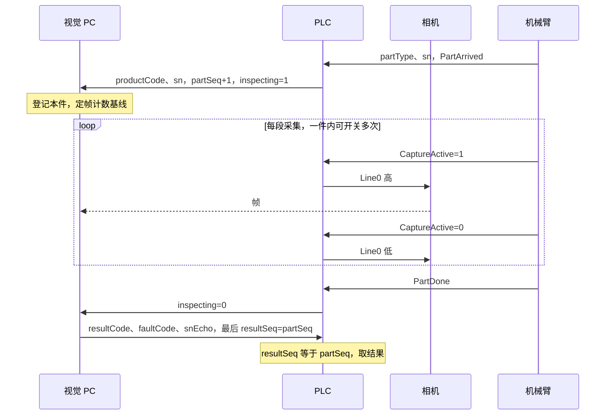

# 生产通讯协议 9

现行协议。PC 侧已实现（`PROTOCOL_VERSION = 9`），现场 PLC 尚未验收。

与协议 8 不兼容，双方成套切换。

## 一、概要

- **没有握手时序**：PLC 只发布“当前件”，PC 只发布“最近一件的结果”，双方靠件序号对上。没有状态字、确认、故障态和复位，谁也不等谁。
- 机械臂只向 PLC 单向通知：工件到达（带型号与 SN）、拍照信号、工件结束。机械臂不等 PLC 或 PC。
- PLC 只报**型号、序号、SN**；配方与计划由 PC 管理，换示教件、改分段不用改 PLC。
- PC 读到新件只登记、不回写；工件结束后写结果，最后写 `resultSeq`。PLC 看到 `resultSeq` 等于本件 `partSeq` 就取结果，等不到就记未检。
- 视觉不影响生产：任何结果都**不停线**，PC 不在线时机械臂照常工作。

## 二、机械臂 → PLC

不属于 PC 与 PLC 的交互，PC 不读这些信号。接口形式（IO 或总线）由现场定，见第八节。

| 信号 | 类型 | 说明 |
| --- | --- | --- |
| `partType` | Int | 工件类型，即型号，1–32767；PLC 原样作为 `productCode` |
| `sn` | String[50] | 工件 SN |
| `PartArrived` | 位，脉冲 | 工件到达；先写好 `partType`、`sn`，再给脉冲 |
| `CaptureActive` | 位，电平 | 拍照信号：需要采集的涂胶运动期间为 1；一件内可多次开关 |
| `PartDone` | 位，脉冲 | 工件结束；`CaptureActive` 先回 0 再给脉冲 |

- 脉冲宽度不小于 200 ms，PLC 按上升沿处理；`partType`、`sn` 保持到下一件到达。
- 工件到达到拍照信号置 1 之间留出间隔，让 PC 在采集前读到新件（第七节）。

## 三、点表

标准块访问、大端字节序。PLC 只写 DB4，PC 只写 DB2。保留字节为 0。

### DB4：PLC → PC（68 字节）

| 偏移 | 类型 | 名称 | 说明 |
| --- | --- | --- | --- |
| 0 | Int | `plcVersion` | 固定 9 |
| 2 | Int | `plcHeartbeat` | 每 500 ms 变化一次（加 1 或 0/1 交替），3 s 不变判失活 |
| 4.0 | Bool | `inspecting` | 在检：工件到达置 1，工件结束置 0；字节 4–7 的其余位保留 |
| 8 | DInt | `partSeq` | 件序号，1–2147483647，每到一件加 1；0 表示还没有件 |
| 12 | Int | `productCode` | 型号，1–32767 |
| 14 | Int | 保留 | |
| 16 | String[50] | `sn` | 工件 SN |

### DB2：PC → PLC（68 字节）

| 偏移 | 类型 | 名称 | 说明 |
| --- | --- | --- | --- |
| 0 | Int | `pcVersion` | 固定 9 |
| 2 | Int | `pcHeartbeat` | 每 500 ms 在 0/1 间交替，3 s 不变判失活 |
| 4 | Int | 保留 | |
| 6 | Int | `pcMode` | 0 正常，1 维护；仅供 HMI 显示 |
| 8 | DInt | `resultSeq` | 结果对应的 `partSeq`；0 表示没有结果 |
| 12 | Int | `resultCode` | 见第六节 |
| 14 | Int | `faultCode` | 正常 0；检测错误 91–100 |
| 16 | String[50] | `snEcho` | 结果对应的 SN，供 HMI 或 MES 核对 |

## 四、一件的过程

图里只有数据流向，没有互相等待：PLC 的每一步都只由机械臂信号驱动。

## 五、规则

### PLC 侧

| 事件 | 动作 |
| --- | --- |
| `PartArrived` | 写 `productCode`、`sn`，再把 `partSeq` 加 1，最后置 `inspecting`=1 |
| `PartDone` | `inspecting` 置 0，Line0 保持低 |
| `inspecting`=0 且 `resultSeq` 等于 `partSeq`，PC 心跳正常 | 取 `resultCode`、`faultCode` 作为本件结果 |
| 下一件 `PartArrived` 时上一件还没取到结果 | 上一件记未检 |

- **Line0**：`inspecting`=1、`CaptureActive`=1 且现场互锁满足时为高；一件内可多次高低。与 PC 是否在线无关。
- **取结果的等待**：PLC 可以自定一个等待时间提前记未检；不设也可以，下一件到达就是期限。
- **PC 心跳失活**时不取结果，本件记未检。
- **序号**：`partSeq` 建议放保持性数据，掉电不丢，到 2147483647 后回 1。PC 不要求序号递增，PLC 清零或重置序号不需要通知 PC。
- **上一件未结束又来新件**：按新件的 `PartArrived` 处理，上一件记未检。
- **SN**：TIA `String[50]`，头字节为声明长度 50、实际长度 1–50；字符为 0x20–0x7E，去掉首尾空格后不能为空；用字符串赋值写入，禁止块操作覆盖。

### PC 侧

- **接件**：`inspecting` 由 0 变 1，或在检期间 `partSeq` 变了，即为新件；连续两次轮询内容一致后登记本件、定帧计数基线，不回写 PLC。型号、SN 以登记时读到的为准。
- **结束**：本件 `inspecting` 回 0 即进入收尾，判定后先写 `resultCode`、`faultCode`、`snEcho`，最后写 `resultSeq`。写完本件即结束，不等 PLC。
- **不能检测的件**（找不到配方、相机未就绪等）照常登记，工件结束后回 `resultCode`=90 与对应 `faultCode`；维护模式下回 0。这类问题只影响本件。
- **没接到的件**：PC 就绪时已经在检的件、PC 不在线时到达的件，以及 `partSeq` 为 0、SN 或型号不合法的件，PC 不登记、不回结果，PLC 记未检。
- **中途换件**：在检期间 `partSeq` 变了（没收到工件结束），本件记中断（ERR 98），不回结果，接着登记新件。
- **等不到工件结束**：超过 PC 侧设定的运动超时，本件记 ERR 97，不回结果。
- **旧结果不被误取**：PC 只在工件结束后写结果；在检期间读到 `resultSeq` 等于 `partSeq`（PLC 重置过序号、撞上旧结果）时，PC 把 `resultSeq` 写 0。
- **通讯就绪**：PLC 已连接、`plcVersion`=9、PLC 心跳在变化即就绪，不需要复位；任一条件不满足时在检的件记中断，条件恢复后自动回到就绪。
- **早到的帧**：PC 登记本件前收到的帧不计入本件，按缺帧判定。
- **PC 输出保持**：`pcVersion`、`pcMode` 被改写（PLC 重启、DB 重新初始化）时 PC 重新写入。

## 六、结果码

| resultCode | 含义 | 线体处置 |
| --- | --- | --- |
| 0 | 无结论（维护模式） | 放行，记未检 |
| 1 | OK | 放行 |
| 2 | OK，有局部超差 | 放行 |
| 11–14 | NG：位置 / 绝对值 / 断胶 / 胶宽 | 不停线，记 NG |
| 90 | 检测错误，配 faultCode 91–100 | 不停线，记检测错误 |

除 90 外 `faultCode` 为 0。维护模式下 PC 每件照常采图，结果码固定写 0，PLC 按未检放行；PLC 只看结果码，不需要读 `pcMode`。PC 侧行为见 [在线投运方案](../architecture/online-commissioning.md) 与 [维护模式决策](../decisions/maintenance-mode.md)。

## 七、时间参数

| 项 | 默认 | 说明 |
| --- | --- | --- |
| 心跳 | 500 ms 变化一次 | 双方 3 s 不变判失活 |
| 机械臂通知脉冲 | ≥ 200 ms | `PartArrived`、`PartDone` |
| 到达到拍照信号 | ≥ 2 s | 覆盖 PC 发现新件（两次轮询确认）与登记落盘；现场一般有数秒 |
| PC 收尾窗口 | 1000 ms | `inspecting` 回 0 后继续收帧 |
| PC 帧测量超时 | 3000 ms | PC 出结果最晚在 `inspecting` 回 0 后约 4 s（收尾窗口加测量超时）；PLC 自定的等待时间不应短于此 |

## 八、需 PLC 方提供

1. 机械臂信号 `partType`、`sn`、`PartArrived`、`CaptureActive`、`PartDone` 的接口形式与地址。
2. “记未检 / 记 NG / 记检测错误”的去向：HMI 显示、输出位或上报 MES。
3. Line0 输出点与三台相机的接线。
4. DB4、DB2 在现场工程中的块号是否沿用原位置。
5. CPU 型号与固件，确认已允许 PUT/GET 访问。

## 仓库内的实现

- 点表模板与标签：`src-tauri/src/inspection.rs`、`src/business/plcTags.ts`（PLC 页名称旁的字段说明 `plcTagHelp`）。
- 点表校验与读写：`src-tauri/src/handshake.rs`；会话：`src-tauri/src/plc_session.rs`。
- 仓库不保存 PLC 程序，PLC 侧按本规格由现场工程实现。PC 侧由进程内 S7 服务（`tools/production-simulator/src/s7_server.rs`）配合生产模拟器测试。
