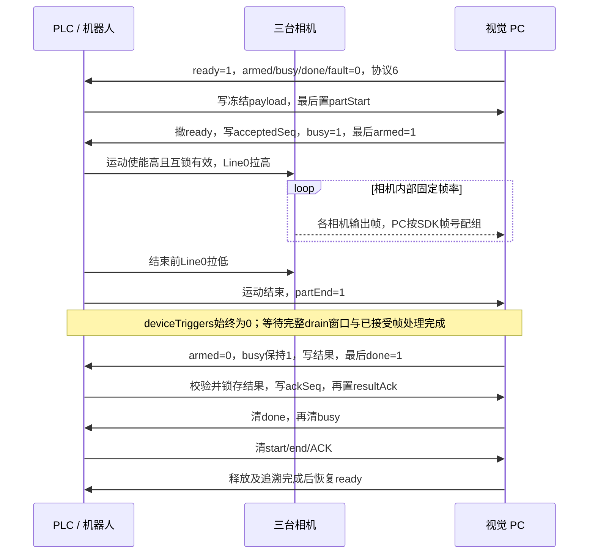
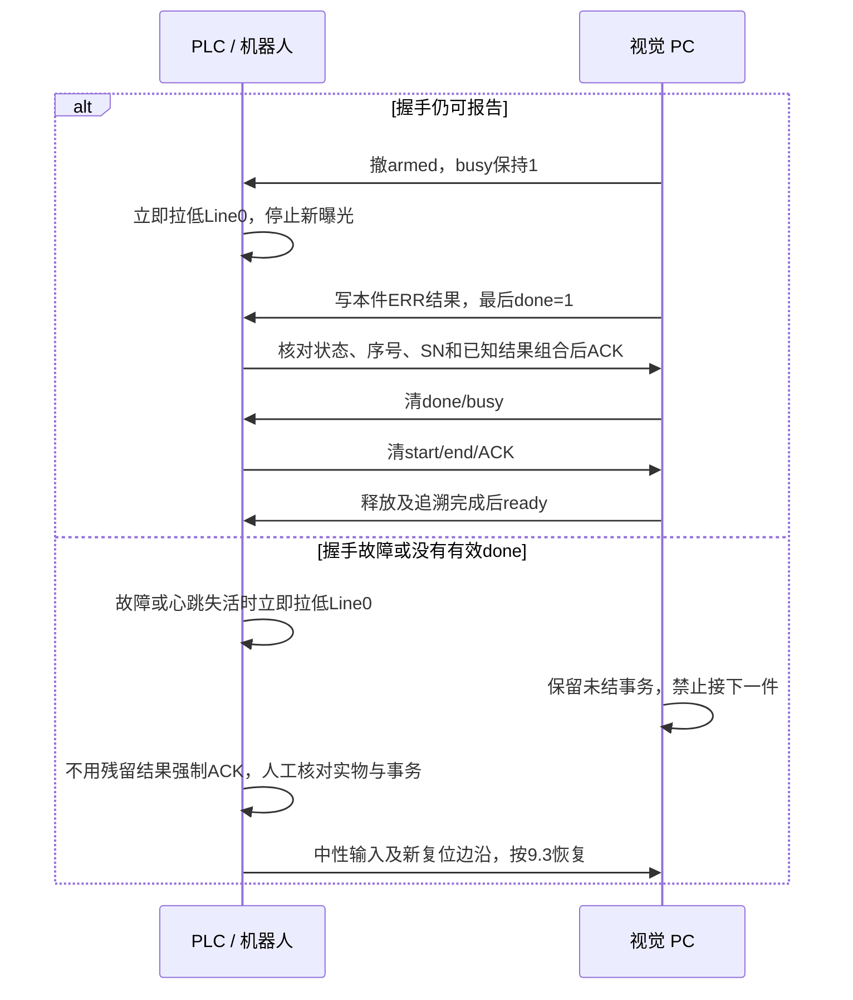
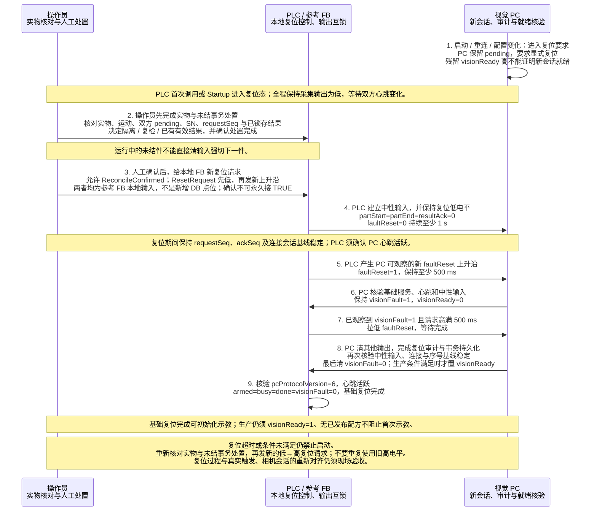

# GlueSight PLC 通讯协议

文档修订：4.3；更新日期：2026-10-24；线上握手协议版本：6。

本次改为 Line0 高电平连续采集，协议版本保持 6，DB4 / DB2 布局、字段名、类型、偏移、握手顺序、心跳及复位不变。PLC 负责运动与采集使能门控，相机按软件设定帧率自行曝光，默认 10 fps。

`deviceTriggers` 保留写 0，PC 不使用它计算丢帧、收尾或下一件基线。`shotCount` / `deviceShots` 仍表示 PC 导出计划的 expectedTotal。旧拍照点配方从未部署，不再保留运行时兼容。

三台相机按各自 SDK 帧号配组，不保证曝光时刻同步。Software 单帧触发仅用于标定和调试；PLC 整轮采集和生产必须使用 Line0。一件只有一个在途事务，完成结果确认和双方释放后才能开始下一件。

生产使用 DB2 / DB4 协议 6；整圈示教使用独立 [示教接口 V1](teaching-capture-sequence.md) 的 DB6 / DB12，不再复用生产开始、结束和结果握手。示教完成不产生生产良品信号。双方须成套更新；参考 SCL 未在 TIA Portal 或真实 CPU 编译运行，仍须现场验证。

## 1 通讯参数与分工

| 项目 | 约定 |
| --- | --- |
| 连接方式 | PC 作为 S7 ISO-on-TCP 客户端，读写 PLC 共享区 |
| PLC | 西门子 S7-1200（现场已由 S7-200 SMART 更换）；CPU 订货号与固件版本现场补填 |
| PLC IP / 端口 | 默认 192.168.2.10 / 102；工控机连接 PLC 的网口须在同一网段 |
| 连接参数 | 机架 0 / 插槽 1，TSAP 按机架/插槽自动生成；PC 请求 PDU 480，以 CPU 协商结果为准。CPU 须在“防护与安全 → 连接机制”中允许来自远程对象的 PUT/GET 访问 |
| 共享区 | 两个标准 DB，均取消“优化的块访问”：DB4 为 PLC → PC，DB2 为 PC → PLC |
| 区域长度 | DB4 至少 90 字节（0–89）；DB2 至少 72 字节（0–71） |
| 数值字节序 | 大端 ABCD；Int 为 16 位有符号，本协议只使用 0–32767；DInt 为 32 位有符号，本协议只使用 0–2147483647；读到负数一律按字段越界拒绝 |
| 字符串 | 工件 SN 为 TIA `String[50]`（S7 STRING：声明长度 + 实际长度 + 字符），SN 1–50 个字符，见第 2.1 节 |
| PC 轮询周期 | 一期 S7 模板默认 50 ms；每次分两段读取 DB4 字节 0–89 与 DB2 字节 0–71 |
| 心跳 | 双方默认每 500 ms 翻转一次；观察变化，3 s 不变化判失活 |
| 自动连接 | 一期模板默认关闭；连接成功后仍必须显式复位 |
| 写入所有权 | PLC 只写 DB4；PC 只写 DB2 |

DB4 点位在 PC 点表中必须设为只读，DB2 点位设为读写。PLC 程序不得写 DB2，禁止整块清零、`FILL_BLK`/`MOVE_BLK` 等块操作覆盖 DB2；DB4 内保留字节保持 0。PC 的 50 ms 轮询不承担拍照位置或曝光时刻控制。

现场输出必须满足第 5 节布防互锁与机器人 `MotionActive` 高电平，才能向相机 Line0 输出高电平。任一条件失效立即拉低。软件设置相机帧率，PLC 不产生逐帧脉冲。

**在 TIA 中建立 DB4 / DB2：** 取消“优化的块访问”后，按第 2、3 节表格自上而下的顺序声明变量，保留位与保留字节也要声明（Bool 占位、Byte 或 Array of Byte），使编辑器“偏移量”列与表中“偏移”列逐行一致；Int、DInt、String 只能落在偶数字节，顺序或类型不同会让后续字段整体错位。建好后导出或截图偏移量列，与本表核对后再联调。

## 2 PLC 写入 PC 读取点表（DB4）

标签名称区分大小写，PC 严格握手要求每个标签只配置一次。

| 地址 | 偏移 | 类型 | 标签 | 含义及要求 |
| --- | --- | --- | --- | --- |
| DB4.DBX0.0 | 0.0 | Bool | `partStart` | 请求提交标志；payload 写完后最后置 1，保持至结果释放 |
| DB4.DBX0.1 | 0.1 | Bool | `partEnd` | 本件运动结束且采集输出已拉低后置 1，保持至释放；PC 等待完整收尾窗口 |
| DB4.DBX0.2 | 0.2 | Bool | `resultAck` | 结果确认标志；锁存有效结果并写 ackSeq 后置 1 |
| DB4.DBX0.3 | 0.3 | Bool | `faultReset` | 明确复位请求；必须先观察低电平，再有新上升沿 |
| DB4.DBX0.4 | 0.4 | Bool | `plcHeartbeat` | PLC 心跳，每 500 ms 翻转 |
| DB4.DBX0.5–0.7 | 0.5 | Bool ×3 | 保留 | 保持 0 |
| DB4.DBB1 | 1.0 | Byte | 保留 | 保持 0 |
| DB4.DBW2 | 2.0 | Int | `protocolVersion` | 固定 6；其他值（含 5）拒绝 |
| DB4.DBD4 | 4.0 | DInt | `requestSeq` | 本件事务序号，1–2147483647，非零且递增 |
| DB4.DBW8 | 8.0 | Int | `productCode` | 生产配方产品代码，1–32767；PC 手动选配方时也必须匹配。示教 V1 不使用本字段 |
| DB4.DBW10 | 10.0 | Int | `shotCount` | 与 shotCount 填同一 expectedTotal；生产核对计划，示教 V1 不使用本字段 |
| DB4.DBD12 | 12.0 | DInt | `planVersion` | 生产使用 PC 分配并导出的计划版本，不得为 0 或负数；示教 V1 不使用本字段 |
| DB4.DBD16 | 16.0 | DInt | `planReserved` | 固定 0，非零拒绝处理 |
| DB4.DBW20 | 20.0 | Int | `deviceShots` | 与 shotCount 填同一 expectedTotal；生产核对计划，示教 V1 不使用本字段 |
| DB4.DBB22–27 | 22.0 | Byte ×6 | 保留 | 保持 0 |
| DB4.DBD28 | 28.0 | DInt | `ackSeq` | 确认时回显本件 resultSeq，新件开始前清为 0 |
| DB4.DBW32 | 32.0 | Int | `deviceTriggers` | 保留字段，PLC 始终写 0；PC 不用于告警、收尾或基线计算 |
| DB4.DBB34–37 | 34.0 | Byte ×4 | 保留 | 保持 0 |
| DB4.DBB38.50 | 38.0 | String[50] | `partSn` | 工件 SN 字符串，占 38–89；不替代事务序号，规则见第 2.1 节 |

保留空间：DBX0.5–0.7、DBB1、DBB22–27、DBB34–37。保留字节保持 0，不定义设备通道或计数字段，不新增跨方向写入字段。

## 3 PC 写入 PLC 读取点表（DB2）

| 地址 | 偏移 | 类型 | 标签 | 含义及要求 |
| --- | --- | --- | --- | --- |
| DB2.DBX0.0 | 0.0 | Bool | `visionReady` | 可以接收下一件；连接成功不等于就绪 |
| DB2.DBX0.1 | 0.1 | Bool | `armed` | 本件相机布防完成，必须结合 acceptedSeq 判断 |
| DB2.DBX0.2 | 0.2 | Bool | `busy` | 事务处理中，包含等待结果确认阶段 |
| DB2.DBX0.3 | 0.3 | Bool | `done` | 结果有效；PC 写完结果 payload 后最后置 1 |
| DB2.DBX0.4 | 0.4 | Bool | `visionFault` | 协议或设备故障，停止新触发并处置 |
| DB2.DBX0.5 | 0.5 | Bool | `pcHeartbeat` | PC 通讯心跳，默认每 500 ms 翻转 |
| DB2.DBX0.6–0.7 | 0.6 | Bool ×2 | 保留 | PC 写 0 |
| DB2.DBB1 | 1.0 | Byte | 保留 | PC 写 0 |
| DB2.DBW2 | 2.0 | Int | `pcProtocolVersion` | 成功复位后为 6 |
| DB2.DBD4 | 4.0 | DInt | `resultSeq` | 本件结果事务序号，应等于 requestSeq |
| DB2.DBW8 | 8.0 | Int | `resultCode` | 生产整件结果，见第 6 节；示教 V1 不使用本字段 |
| DB2.DBW10 | 10.0 | Int | `faultCode` | 检测异常码，正常质量结果为 0 |
| DB2.DBD12 | 12.0 | DInt | `acceptedSeq` | 已接受并布防的 requestSeq |
| DB2.DBD16 | 16.0 | DInt | `acceptedPlanReserved` | 布防时写 0，核对接受状态时应为 0 |
| DB2.DBB20.50 | 20.0 | String[50] | `resultSn` | 本件结果 SN，占 20–71；实际长度与字符须与 partSn 相等 |

保留空间：DBX0.6–0.7、DBB1。PLC 不写 DB2。`done=0` 时结果字段可能保留上件数值，不能作为新件结论。

### 2.1 工件 SN 字符串

`partSn`（`DB4.DBB38`）与 `resultSn`（`DB2.DBB20`）均为 TIA `String[50]`，各占 52 字节，PC 点表类型为 `string`：

| 字节 | 内容 |
| --- | --- |
| +0 | 声明最大长度，固定 50（0x32），由 TIA 按声明自动维护 |
| +1 | 实际长度 0–50 |
| +2 起 | 字符；未用字节 PC 写入时补 0 |

PLC 用字符串赋值或 `S_MOVE` 写 `partSn`，不要按字节拼写头字节；禁止用块操作覆盖 SN 区。

**长度字节异常不是请求 payload 不合法。** PC 每个轮询周期都读取两段 SN：声明长度不为 50 或实际长度大于 50 时，该点位读错误，与心跳、序号等字段读失败一样直接进入视觉故障（`visionFault=1`、`visionReady=0`），与是否有 `partStart` 无关。两段的恢复责任按所有者划分：

- `resultSn`（DB2）头字节异常时，PC 在显式复位中自行恢复：满足第 8 节复位条件后，PC 先把 `resultSn` 写回空串（头为 `32 00`），读回确认并记入复位审计，再继续清输出、置 `visionReady`。
- `partSn`（DB4）头字节异常时 PC 不写该区，显式复位无法完成；必须由 PLC 写回空串（头为 `32 00`），再按第 8 节复位。

PC 的自恢复只是兜底，不改变 PLC 职责：禁止整块覆盖。

SN 规则：

- 长度 1–50 个字符；每个字符为 ASCII 可打印字符 0x20–0x7E；去掉首尾空白后不能为空。
- SN 原样保存与回显，PC 不做 trim 或大小写变换。PLC 侧要求 `resultSn` 与 `partSn` 的实际长度及每个字符相等；PLC 比较时不要依赖未用字节，建议直接用字符串比较（`==`）整个字符串。
- SN 不替代 `requestSeq`；同一 SN 复检仍须新的 `requestSeq`。
- 离线产线（仿真）为每件分配形如 `OFFLINE-0001234567`（`OFFLINE-` 加 10 位数字）的 SN，同一离线运行内唯一，样本件按 SN 字符串认领。

长度字节正常但内容不合规的 `partSn`（实际长度为 0、含 0x20–0x7E 以外字符、去掉首尾空白后为空）在 PC 读取请求时判定，与其他请求 payload 不合法完全同样处理，见第 5 节。

## 4 分段计划与高电平采集

生产请求携带 PC 导出的产品代码、计划版本与 expectedTotal。PC 核对相机绑定、已发布配方及标定环境。帧率改变需要重新标定、验证和发布，不直接复用旧的预期帧数。

整轮示教由 PC 发起，按实际 SDK 帧号归组，不发送估算帧数或生产结果码；通过独立示教状态通知结束、确认和释放，见第 4.1 节。旧拍照点采集已停用。

帧号缺口、传输丢帧和相机之间帧数差异用于诊断。帧数相差超过 1 的孤立相机产生丢帧告警；整件帧组数超出标定值及容差产生帧数异常标记。deviceTriggers 不参与任何比较。

### 4.1 整圈示教采集的用途与请求

整圈采集已改为 [示教接口 V1](teaching-capture-sequence.md)：DB6 由 PC 写，DB12 由 PLC 写，各 10 字节、五个 Int。轮次编号范围 1–32767；一次点击启动一轮，PLC 接受后无需等待 PC 再布防。

PC 发请求前准备图像接收及保存；PLC 负责现场许可、生产互斥、运动和 Line0。原图完成后仍需等待 PLC 确认及双方释放。取消不会立即解除互锁。生产 partStart 不再被重定向为示教请求；生产字段和握手只按本节后续生产流程解释。

首次部署需应用包含示教 V1 的点表并导入对应 PLC 程序。PC 不写 PLC 所有字段，禁止以手动写点代替示教状态机。现场已确认 DB6 / DB12 可用；真实 CPU 编译与联调仍由现场完成。

## 5 单件握手流程

| 阶段 | PLC 动作 | PC 动作 |
| --- | --- | --- |
| 等待就绪 | start/end/ACK 为 0，心跳活跃 | ready=1，armed/busy/done/fault=0，协议 6 |
| 提交请求 | 写序号、SN、产品代码、计划版本与预期帧数，deviceTriggers=0，最后置 partStart | 核对身份、已发布配方、相机及生产帧率 |
| 等待布防 | 保持请求，采集输出为低 | 撤 ready，写 acceptedSeq，置 busy，最后置 armed |
| 运动采集 | MotionPermit 后开始运动；MotionActive 高且互锁有效时 Line0 高 | 相机按设定帧率曝光，PC 按 SDK 帧号配组并测量 |
| 结束 | 先拉低采集输出，再置 partEnd，start 保持为 1 | 等待完整 drain 窗口和已接受帧的测量/写盘完成 |
| 发布结果 | 等待 done，不提前 ACK | 撤 armed，保持 busy，写结果 payload，最后置 done |
| 确认 | 验证并锁存结果，写 ackSeq，再置 resultAck | 匹配 ACK 后先清 done，再清 busy |
| 释放 | done=busy=0 后清 start/end/ACK | 确认释放及追溯完成后恢复 ready |

高电平必要条件：armed=busy=1，done=partEnd=visionReady=visionFault=0，acceptedSeq=requestSeq，planReserved=acceptedPlanReserved=0，双方心跳活跃、现场互锁有效且 MotionActive=1。运动结束、任一故障或 armed 撤销立即拉低。运动放行与采集输出分开，避免机器人等待采集输出而无法开始运动。

partEnd 后不因当前帧数达到某个值而提前结束，等待完整 drain 窗口。收尾完成前禁止下一件。下一件帧号基线取当前会话观察到的最高 SDK 帧号，PLC 保留字段不参与。

请求格式不合法、版本不符或身份在途中改变进入视觉故障。生产计划不匹配返回 90/94 或 90/100。计划拒收或提前故障允许无 partEnd 返回 90/91–100；正常 OK/NG 必须已收到 partEnd。有效结果要求 done=1、armed=0、busy=1、ready=0、结果序号和 SN 匹配，结果码与异常码组合合法。ACK 只表示收到结论，不代表良品。

序号必须递增，达到 DInt 上限前处置未结件并在中性状态显式复位，不直接回绕。

## 6 结果与异常码

下表仅适用于 DB2 / DB4 的生产事务。示教采集使用独立 DB6 / DB12 状态与原因码，不返回本表结果；详见第 4.1 节。

| resultCode | 名称 | PLC 处理 |
| --- | --- | --- |
| 1 | OK | 合格结论 |
| 2 | OK_WITH_EXCURSION | 存在局部超差，但符合配方允许条件的合格结论 |
| 11 | NG_POSITION | 位置偏差不合格 |
| 12 | NG_ABSOLUTE | 绝对限值超差不合格 |
| 13 | NG_GAP | 断胶不合格 |
| 14 | NG_WIDTH | 胶宽超差不合格；段模型的溢胶（某帧最大胶宽超过溢胶上限）、直线段胶宽不均也用此码，原因文字区分 |
| 90 | ERR_INSPECT | 未形成有效质量判定，按 faultCode 处置 |

结果码 1、2、11–14 必须配 `faultCode=0`；90 配以下已知非零异常码。未知组合按故障处置，禁止按 OK 放行。协议 6 不新增结果码或异常码；气泡、拉丝本阶段不检，只在 PC 结果中标“未检项”，不影响结果码。

| faultCode | 含义 |
| --- | --- |
| 0 | 无检测异常，质量 NG 由 resultCode 表示 |
| 91 | 缺帧。段配方只有三台相机整件没有一帧测成（没收到帧，或收到的都没测成）才返回；单台相机缺帧只标“检测不完整”，不改 OK/NG |
| 92 | 定位失败：工件位置基准无效（定位失败或胶路两端搬移超限）导致胶偏判不了；同一件另有 NG 时报该 NG，不报 92。只有旧拍照点配方的特征定位会产生，段模型不使用，保留 |
| 93 | 无效测量点 |
| 94 | 拍照计划或数量不匹配：生产请求的 `shotCount` 或 `deviceShots` 不等于 PC 当前计划的 ΣN_exp |
| 95 | 配方不可用 |
| 96 | 多余帧。协议 6 起段配方不再使用：帧数超出 N_exp ± 容差只记“帧数异常”告警；常量与本表保留，当前不再产生 |
| 97 | 运动结束超时 |
| 98 | 设备丢失，包括相机断连、会话变化 |
| 99 | 布防或处理超时、测量执行失败等处理异常，结合 PC 原因查看 |
| 100 | 计划版本、相机绑定或计划内容与 PC 不一致 |

`visionFault` 是握手层故障信号，与 `faultCode` 不同。心跳失活、请求身份变化或回写失败可能只有 visionFault 和 PC 错误原因，没有可提交的 done；此时保留未结事务，不能拿残留结果 ACK。

PLC 参考 FB 的 `LocalDiagnostic` 只在本地使用，不写 `faultCode`（DB2.DBW10）：7000 启动或未知状态需复位，7001 PC 心跳超时，7002 PC 协议故障，7003 阶段超时，7004 新件计划或前置条件错误，7005 布防或结果身份/状态不符，7006 保留不使用，7007 序号耗尽，7008 在途 payload 改变，7009 外部互锁故障。

## 7 心跳与时间参数

两端时间参数作用不同，现场必须一起核对，不能仅把 PLC 的等待时间写长。

| PC 生产检测设置 | 默认 | 作用 |
| --- | --- | --- |
| arm_ms | 500 ms（100–5000） | 检测布防总预算：从 PC 确认并记下 partStart 请求起，到 armed 等布防输出读回确认为止；提交前超时返回 90/99，布防回写、读回确认失败或确认时已超预算进入协议故障；布防后的握手日志落盘不计入 |
| motion_ms | 30000 ms | 等待运动结束 |
| drain_ms | 1000 ms | partEnd 后收尾收帧窗口 |
| proc_ms | 3000 ms | 等待测量完成 |
| ack_ms | 5000 ms | 等待 ACK 与释放的告警阈值 |

布防回写或读回确认失败、超时时，PC 进入 visionFault 并保留事务，不保证还有 done/99，PLC 应按故障处置。PLC 的 ArmTimeout 从 partStart↑ 计时，须覆盖 PC 开始双读确认（约 2 个轮询周期）、请求落盘、`arm_ms` 与布防落盘。两次落盘在磁盘繁忙时实测各可达约 0.65 s，合计最坏约 `arm_ms` + 1.4 s，因此 ArmTimeout 不得小于 `arm_ms` + 2 s，建议保持默认 10 s（覆盖 PC 上限 5000 ms 及上述开销）。PC 负载很高时发现 partStart 还会再滞后，不要把 ArmTimeout 压到下限。ACK 或释放等待超过 PC 阈值只告警并保持事务，不自动丢弃 done 或开始下一件。PC S7 模板心跳默认 500 ms，契约允许配置 100–1000 ms；两端失活阈值均为 3 s。

示教 V1 使用独立接受、运动、收尾、确认和释放预算，见 [示教接口 V1](teaching-capture-sequence.md) 第 5 节。生产超时设置不替代示教状态机的时限。

| PLC 参考 FB 输入 | 默认 | 作用 |
| --- | --- | --- |
| ArmTimeout | 10 s | 等待 PC 布防；不得小于 `arm_ms` + 2 s |
| MotionTimeout | 30 s | 等待本件运动与触发结束 |
| ResultTimeout | 10 s | 等待 PC 结果，包括提前终止后的结果 |
| ReleaseTimeout | 10 s | 等待 PC 释放及下一次就绪，各阶段分别计时 |
| ResetTimeout | 10 s | 复位中性、请求确认及等待完成三个阶段分别计时 |

PLC 阶段超时锁入故障并停止新触发，保留 pending。现场根据实际运动时间、网络与处理耗时调整双方预算，预留余量；不要把 50 ms 轮询周期当作相机触发间隔或节拍保证。

## 8 启动重连与故障复位

PC 启动、S7 重连或配置变化后要求显式复位；PLC 参考 FB 首次调用及 Startup 也进入复位态。残留 ready 高电平不证明新会话可接件，双方持久化的 pending 不因重连自动结束。

PC 写入或读取遇到断开、通讯超时或应答帧异常时，立即关闭当前 S7 连接并重新建连，不在原连接上继续收发，避免迟到应答被当成下一次请求的应答。这类读写失败因此一律按重连处理：PC 进入复位要求并撤销视觉就绪，未结事务保留，PLC 须按本节重新复位。

1. 停止新触发，核对实物、机器人动作、双方 pending、SN、requestSeq 和已锁存结果，决定隔离、复检或已有有效结果。
2. 操作员确认处置完成，再允许 `ReconcileConfirmed`。该输入不应永久接 TRUE。
3. 对参考 FB 的本地 `ResetRequest` 先置低，再发新上升沿；PLC 释放 partStart/partEnd/resultAck。运行中的未结件不能直接清输入强切下一件。
4. 保持 faultReset 为低至少 1 s，保持 requestSeq、ackSeq 基线不变，随后置 faultReset 高至少 500 ms，形成 PC 可观察的新边沿。
5. PC 核验基础服务、PLC 心跳及中性输入，保持 visionFault=1；PLC 观察到该高电平且 faultReset 已保持至少 500 ms 后，将 faultReset 拉低，进入等待完成阶段。
6. PC 观察到 faultReset 拉低后清本侧其他输出，记录复位审计并持久化结束原 pending，最后清 visionFault。PLC 确认 pcProtocolVersion=6、armed/busy/done/visionFault 全为 0 且心跳正常，才认定基础复位成功。超时则重新处置并发新低→高复位请求。

基础复位不依赖已发布生产配方；visionReady 仅在生产条件满足且无示教占用时置 1。PLC 基础复位完成后仍须 visionReady 才能接生产件。此复位确认顺序与示教扩展一起更新，PC 和参考 PLC 程序必须配套部署，旧的“保持 faultReset 高并等待 ready”程序不可继续使用。

段配方每台相机的帧归属以 SDK 帧号为准：本件帧序号 = 帧号 − 该相机基线，下一件基线取当前会话观察到的最高帧号。`deviceTriggers` 不参与。持续缺帧、传输丢帧或相机间帧数偏差根据对应原因排查采集使能、相机取流与带宽。

无在途事务时，设备短暂未就绪可撤 ready 并在恢复后自动就绪；PLC 遗留 end/ACK 时 PC 等待 PLC 清除。PC 输出偶发被重置可审计后恢复，60 s 内第 3 次被覆盖会故障。上述空闲恢复不替代启动、重连或心跳中断后的显式复位。

## 9 通讯时序图

### 9.1 正常生产一件

### 9.2 提前终止与故障

### 9.3 启动与显式复位

启动、重连或配置变化后，先处置未结件，再建立中性基线与新复位边沿；连接成功不等于可以接件，普通空闲恢复不能代替显式复位。

### 9.4 整圈示教采集 V1

PC 发起启动的第一版接口及示教时序图独立维护于 [整圈示教采集接口 V1](teaching-capture-sequence.md)，分配 DB6（PC 写）和 DB12（PLC 写），通过一个轮次编号及双方状态握手。PC 和 PLC 参考程序已接入，现场 DB 编号已确认，仍需 TIA 编译及现场验收；生产协议 6 和 DB2 / DB4 保持不变。

## 10 验收与实施依据

1. 核对 DB4 / DB2 偏移、协议 6、读写所有权与心跳；启动及重连必须显式复位。
2. 核对布防前 Line0 低、运动采集期间高、结束先低再 partEnd；故障及心跳超时及时拉低。
3. 验证相机设定/回读/实际帧率、低电平停止新曝光、Software 一次一帧及恢复 Line0 后生产检查。
4. 向预留 deviceTriggers 写 0 或其他测试值不应改变 PC 帧数告警、排空和下一件基线；正式 PLC 始终写 0。
5. 验证尾帧在 drain 窗口内仍属于本件，完整窗口及测量/写盘完成后才发布结果；ACK/释放前禁止下一件。

实现入口：[S7 接入契约](plc-s7-phase1.md)、[通用 SCL](../../scripts/s7-handshake/phase1_plc.scl)、[现场 SCL](../../scripts/s7-handshake/site/README.md)。历史协议演进与测试证据保留在 [分段连拍决策](../decisions/segment-burst.md)。本次版本保持 6，因此上线时必须成套更新 PLC 高电平程序和相机配置，不能凭版本号判断现场仍是旧脉冲语义还是新语义。
