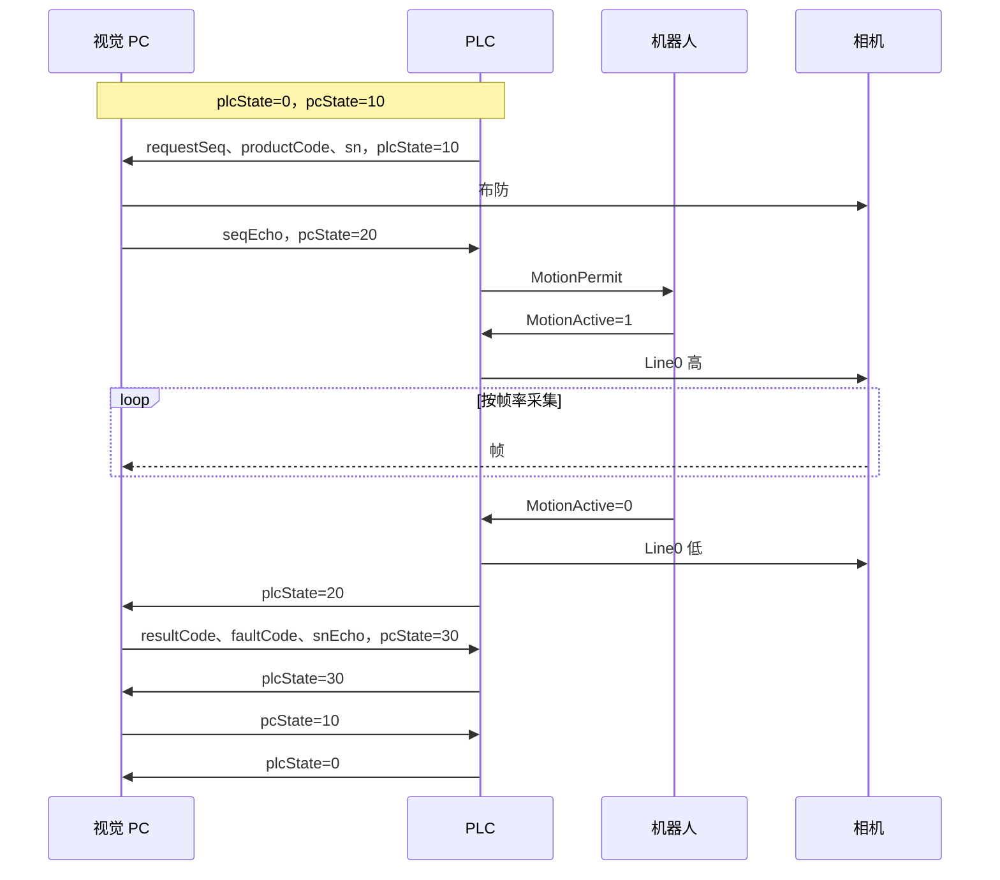

# 生产通讯协议 7

现行协议。PC 侧已实现（`PROTOCOL_VERSION = 7`），现场 PLC 尚未验收。

与协议 6 不兼容，双方成套切换。

## 一、概要

- PLC 只报**型号、序号、SN**；配方与计划由 PC 管理，重新标定不用改 PLC。
- 双方各用一个**状态整数**握手，序号由 PC 回显。
- PC 用 `pcMode` 告知是否处于**维护模式**；维护期间不给质量结论，PLC 按未检放行。
- 视觉不影响生产：任何结果都**不停线**，PC 不在线时机器人照常工作。

## 二、点表

标准块访问、大端字节序。PLC 只写 DB4，PC 只写 DB2。

### DB4：PLC → PC（68 字节）

| 偏移 | 类型 | 名称 | 说明 |
| --- | --- | --- | --- |
| 0 | Int | `plcVersion` | 固定 7 |
| 2 | Int | `plcHeartbeat` | 每 500 ms 变化一次（加 1 或 0/1 交替），3 s 不变判失活 |
| 4 | Int | `plcState` | 见第三节 |
| 6 | Int | `plcReason` | 原因码，见第三节 |
| 8 | DInt | `requestSeq` | 事务序号，1–2147483647，递增 |
| 12 | Int | `productCode` | 型号，1–32767 |
| 14 | Int | 保留 | 0 |
| 16 | String[50] | `sn` | 工件 SN，见第六节 |

### DB2：PC → PLC（68 字节）

| 偏移 | 类型 | 名称 | 说明 |
| --- | --- | --- | --- |
| 0 | Int | `pcVersion` | 固定 7 |
| 2 | Int | `pcHeartbeat` | 每 500 ms 在 0/1 间交替，3 s 不变判失活 |
| 4 | Int | `pcState` | 见第三节 |
| 6 | Int | `pcMode` | 0 正常，1 维护 |
| 8 | DInt | `seqEcho` | 回显 `requestSeq` |
| 12 | Int | `resultCode` | 见第七节；维护模式下为 0 |
| 14 | Int | `faultCode` | 正常 0；检测错误 91–100；PC 故障 101 |
| 16 | String[50] | `snEcho` | 回显 `sn` |

## 三、状态

| plcState | 含义 |
| --- | --- |
| 0 | 空闲 |
| 10 | 请求检测 |
| 20 | 运动结束，Line0 已拉低 |
| 30 | 已确认结果 |
| 90 | 故障 |
| 99 | 复位请求 |

| pcState | 含义 |
| --- | --- |
| 0 | 未就绪 |
| 10 | 就绪 |
| 20 | 已布防 |
| 30 | 结果有效 |
| 90 | 故障 |
| 99 | 复位请求 |

| plcReason | 含义 |
| --- | --- |
| 0 | 无 |
| 4 | 现场互锁不满足 |
| 5 | 协议或状态非法（版本不符、非法迁移、序号或 SN 回显不符、结果组合非法） |
| 6 | PC 心跳失活 |
| 7 | 运动超时 |
| 8 | 等待 PC 结果超时 |
| 9 | 现场执行故障 |
| 10 | 等待 PC 回就绪超时 |
| 11 | 等待 PC 布防超时 |
| 12 | 序号耗尽 |
| 13 | 复位条件不满足，拒绝软件复位 |
| 14 | 在途中 PC 故障或未就绪 |

plcState=90 时 `plcReason` 非 0，其余状态为 0。pcState=90 时 `faultCode`=101（PC 握手故障），与检测错误的 91–100 区分。

## 四、时序：正常一件

## 五、状态迁移（PLC 侧）

| plcState | PC 状态或事件 | PLC 动作 | 进入 |
| --- | --- | --- | --- |
| 0 | 来件，pcState=10 | 写请求，最后置 10 | 10 |
| 0 | 来件，pcState≠10 | 不提交请求，给 MotionPermit，Line0 低，本件记未检 | 0 |
| 10 | pcState=20，`seqEcho=requestSeq` | 给 MotionPermit，按门控输出 Line0；运动结束拉低 Line0 | 20 |
| 10 | pcState=30（拒收） | 不运动，核对结果 | 30 |
| 10 | 等布防超时 | 给 MotionPermit，Line0 低，本件记未检 | 90（11） |
| 10 / 20 | pcState=0、90，或 PC 心跳失活 | Line0 立即拉低，不打断机器人运动，本件记未检 | 90（心跳失活 6，PC 故障或未就绪 14） |
| 20 | pcState=30 | 核对 `seqEcho`、`snEcho`、结果组合；合格则锁存结果 | 30；不合格 90（5） |
| 20 | 等结果超时 | 本件记未检 | 90（8） |
| 30 | pcState=10 | 清本件 | 0 |
| 30 | 等回就绪超时 | 已锁存的结果照常处置 | 90（10） |
| 10 / 20 / 30 | pcState=99 | Line0 低，未出结果的件记未检，清未结事务 | 0 |
| 90 | 来件 | 不提交请求，给 MotionPermit，本件记未检 | 90 |
| 90 | pcState=99，现场允许 | 清故障 | 0；不允许则保持 90（13） |
| 90 | 操作员在现场复位 | 置复位请求 | 99 |
| 99 | pcState=10 | 复位完成 | 0 |

任何状态下运动超时：Line0 拉低，本件记未检，进入 90（7）。

## 六、规则

- **写入顺序**：先写数据，最后写状态；读方连续两次读到一致才处理。
- **Line0**：仅当 plcState=10、pcState=20、`seqEcho=requestSeq`、心跳正常、互锁满足、`MotionActive=1` 时为高。
- **拒收**：PC 可不布防，直接写 90/95 并置 30；PLC 不运动，照常确认。
- **结果确认**：PLC 核对 `seqEcho`、`snEcho` 与结果组合后置 30。
- **故障**：心跳失活、版本不符、在途改序号或 SN、非法迁移 → 置 90，Line0 拉低，未结事务保留。
- **复位（软件发起）**：在途件先在软件确认处置 → PC 置 99 → PLC 保持 Line0 低、清未结事务后置 0 → PC 置 10。PLC 10 s 内未置 0，PC 回 0，可重新发起。
- **复位（PLC 发起）**：PLC 置 99 → PC 置 10 → PLC 置 0。
- **复位通则**：PC 启动或重连后从 0 开始，必须复位；PC 在任何状态都可置 99；双方同时请求时，以 PLC 置 0 为准。
- **PC 不在线**：来件时 pcState≠10，PLC 不等待 PC，直接给 MotionPermit，Line0 保持低，本件记未检。
- **不停线**：任何结果码、PC 故障或不在线都不使线体停止。
- **维护模式取值**：PLC 在锁存结果（置 30）时读取 `pcMode`。
- **SN**：TIA `String[50]`，头字节为声明长度 50、实际长度 1–50；字符为 0x20–0x7E，去掉首尾空格后不能为空；用字符串赋值写入，禁止块操作覆盖；`snEcho` 与 `sn` 按字符串完全相等比较。
- **序号**：`requestSeq` 存在保持性数据中，掉电不丢；从 1 开始，每次提交请求加 1（含被拒收的件）；到 2147483647 时进入 90（12），双方协同处置后从 1 重新开始。

## 七、结果码

| resultCode | 含义 | 线体处置 |
| --- | --- | --- |
| 0 | 无结论（维护模式） | 放行，记未检 |
| 1 | OK | 放行 |
| 2 | OK，有局部超差 | 放行 |
| 11–14 | NG：位置 / 绝对值 / 断胶 / 胶宽 | 不停线，记 NG |
| 90 | 检测错误，配 faultCode 91–100 | 不停线，记检测错误 |

除 90 外 `faultCode` 为 0。`pcMode=1` 时结果码固定为 0，PLC 不看结果码，按未检放行；`pcMode=0` 时结果码为 0 视为非法。

## 八、维护模式

- `pcMode=1`：PC 每件布防、采图，结果码写 0；PLC 看到 `pcMode=1` 即按未检放行。
- 维护期间不因配方或相机问题拒收；只有协议故障才置 90。
- PC 侧行为见 [在线投运方案](../architecture/online-commissioning.md) 与 [维护模式决策](../decisions/maintenance-mode.md)。

## 九、时间参数

| 项 | 默认 | 说明 |
| --- | --- | --- |
| 心跳 | 500 ms 变化一次 | 双方 3 s 不变判失活 |
| PLC 等布防 | 10 s | 不小于 PC 布防预算 + 2 s |
| PLC 等运动结束 | 30 s | 按现场节拍调整 |
| PLC 等结果 | 10 s | 从置 20 起计 |
| PLC 等 PC 回就绪 | 10 s | 从置 30 起计 |
| PC 布防预算 | 500 ms | 100–5000 ms |
| PC 收尾窗口 | 1000 ms | plcState=20 后继续收帧 |
| PC 等软件复位响应 | 10 s | 超时 PC 回 0 |

## 十、需 PLC 方提供

1. 机器人信号：工件到位、MotionPermit、MotionActive 的 IO 点；PC 不在线时机器人跳过等待的实现方式。
2. “记未检 / 记 NG / 记检测错误”的去向：HMI 显示、输出位或上报 MES。
3. Line0 输出点与三台相机的接线。
4. DB4、DB2 在现场工程中的块号是否沿用协议 6 的位置。
5. CPU 型号与固件，确认已允许 PUT/GET 访问。

## 仓库内的实现

- 点表模板与标签：`src-tauri/src/inspection.rs`、`src/business/plcTags.ts`（PLC 页名称旁的字段说明 `plcTagHelp`）。
- 握手与会话：`src-tauri/src/handshake.rs`、`src-tauri/src/plc_session.rs`。
- 仓库不保存 PLC 程序，PLC 侧按本规格由现场工程实现。PC 侧握手由进程内 S7 服务（`src-tauri/src/offline/s7_server.rs`）配合离线仿真产线测试。
