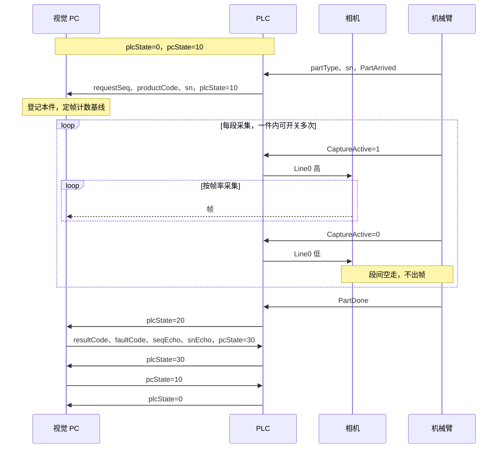

# 生产通讯协议 8

现行协议。PC 侧已实现（`PROTOCOL_VERSION = 8`），现场 PLC 尚未验收。

与协议 7 不兼容，双方成套切换。

## 一、概要

- 机械臂只向 PLC 单向通知：工件到达（带型号与 SN）、拍照信号、工件结束。机械臂不与 PLC 互相确认，不等 PLC 或 PC。
- PLC 只报**型号、序号、SN**；配方与计划由 PC 管理，重新标定不用改 PLC。
- **PC 只登记不回写**：PC 就绪即可接件；PLC 提交请求后不等 PC，按机械臂的拍照信号门控 Line0。
- 双方各用一个**状态整数**握手，序号与 SN 由 PC 在结果阶段回显。
- PC 用 `pcMode` 告知是否处于**维护模式**；维护期间不给质量结论，PLC 按未检放行。
- 视觉不影响生产：任何结果都**不停线**，PC 不在线时机械臂照常工作。

## 二、机械臂 → PLC

不属于 PC 与 PLC 的交互，PC 不读这些信号。接口形式（IO 或总线）由现场定，见第十一节。

| 信号 | 类型 | 说明 |
| --- | --- | --- |
| `partType` | Int | 工件类型，即型号，1–32767；PLC 原样作为 `productCode` |
| `sn` | String[50] | 工件 SN |
| `PartArrived` | 位，脉冲 | 工件到达；先写好 `partType`、`sn`，再给脉冲 |
| `CaptureActive` | 位，电平 | 拍照信号：需要采集的涂胶运动期间为 1；一件内可多次开关 |
| `PartDone` | 位，脉冲 | 工件结束；`CaptureActive` 先回 0 再给脉冲 |

- 脉冲宽度不小于 200 ms，PLC 按上升沿处理；`partType`、`sn` 保持到下一件到达。
- 机械臂不等任何回应，PLC 与 PC 的状态不影响涂胶。
- 工件到达到拍照信号置 1 之间留出间隔，让 PC 在采集前读到请求（第十节）。
- 现场节拍保证上一件握手结束（plcState 回 0）前不会有新件到达。

## 三、点表

标准块访问、大端字节序。PLC 只写 DB4，PC 只写 DB2。

### DB4：PLC → PC（68 字节）

| 偏移 | 类型 | 名称 | 说明 |
| --- | --- | --- | --- |
| 0 | Int | `plcVersion` | 固定 8 |
| 2 | Int | `plcHeartbeat` | 每 500 ms 变化一次（加 1 或 0/1 交替），3 s 不变判失活 |
| 4 | Int | `plcState` | 见第四节 |
| 6 | Int | `plcReason` | 原因码，见第四节 |
| 8 | DInt | `requestSeq` | 事务序号，1–2147483647，递增 |
| 12 | Int | `productCode` | 型号，1–32767 |
| 14 | Int | 保留 | 0 |
| 16 | String[50] | `sn` | 工件 SN，见第七节 |

### DB2：PC → PLC（68 字节）

| 偏移 | 类型 | 名称 | 说明 |
| --- | --- | --- | --- |
| 0 | Int | `pcVersion` | 固定 8 |
| 2 | Int | `pcHeartbeat` | 每 500 ms 在 0/1 间交替，3 s 不变判失活 |
| 4 | Int | `pcState` | 见第四节 |
| 6 | Int | `pcMode` | 0 正常，1 维护 |
| 8 | DInt | `seqEcho` | 回显 `requestSeq` |
| 12 | Int | `resultCode` | 见第八节；维护模式下为 0 |
| 14 | Int | `faultCode` | 正常 0；检测错误 91–100；PC 故障 101 |
| 16 | String[50] | `snEcho` | 回显 `sn` |

## 四、状态

| plcState | 含义 |
| --- | --- |
| 0 | 空闲 |
| 10 | 工件在检：已到达，请求已提交 |
| 20 | 工件结束，Line0 已拉低 |
| 30 | 已确认结果 |
| 90 | 故障 |
| 99 | 复位请求 |

| pcState | 含义 |
| --- | --- |
| 0 | 未就绪 |
| 10 | 就绪 |
| 30 | 结果有效 |
| 90 | 故障 |
| 99 | 复位请求 |

| plcReason | 含义 |
| --- | --- |
| 0 | 无 |
| 4 | 现场互锁不满足 |
| 5 | 协议或状态非法（版本不符、非法迁移、序号或 SN 回显不符、结果组合非法） |
| 6 | PC 心跳失活 |
| 7 | 等工件结束超时 |
| 8 | 等待 PC 结果超时 |
| 9 | 现场执行故障 |
| 10 | 等待 PC 回就绪超时 |
| 12 | 序号耗尽 |
| 13 | 复位条件不满足，拒绝软件复位 |
| 14 | 在途中 PC 故障或未就绪 |

plcState=90 时 `plcReason` 非 0，其余状态为 0。pcState=90 时 `faultCode`=101（PC 握手故障），与检测错误的 91–100 区分。

## 五、时序：正常一件

## 六、状态迁移（PLC 侧）

| plcState | 机械臂通知、PC 状态或事件 | PLC 动作 | 进入 |
| --- | --- | --- | --- |
| 0 | `PartArrived`，pcState=10，PC 心跳正常，型号与 SN 合法 | 写请求，最后置 10 | 10 |
| 0 | `PartArrived`，其余情况 | 不提交请求，Line0 保持低，本件记未检 | 0 |
| 10 | `PartDone` | Line0 拉低 | 20 |
| 10 | 等工件结束超时 | Line0 拉低，本件记未检 | 90（7） |
| 10 / 20 | pcState=0、90，或 PC 心跳失活 | Line0 立即拉低，本件记未检 | 90（心跳失活 6，PC 故障或未就绪 14） |
| 20 | pcState=30 | 核对 `seqEcho`、`snEcho`、结果组合；合格则锁存结果 | 30；不合格 90（5） |
| 20 | 等结果超时 | 本件记未检 | 90（8） |
| 30 | pcState=10 | 清本件 | 0 |
| 30 | 等回就绪超时 | 已锁存的结果照常处置 | 90（10） |
| 10 / 20 / 30 | pcState=99 | Line0 低，未出结果的件记未检，清未结事务 | 0 |
| 90 | `PartArrived` | 不提交请求，本件记未检 | 90 |
| 90 | pcState=99，现场允许 | 清故障 | 0；不允许则保持 90（13） |
| 90 | 操作员在现场复位 | 置复位请求 | 99 |
| 99 | pcState=10 | 复位完成 | 0 |

plcState 不是 10 时收到 `PartDone` 不处理。

## 七、规则

- **写入顺序**：先写数据，最后写状态；读方连续两次读到一致才处理。
- **Line0**：仅当 plcState=10、`CaptureActive`=1、PC 心跳正常、互锁满足时为高；一件内随 `CaptureActive` 可多次高低，各段的帧都计入本件；收到 `PartDone` 后保持低。
- **接件**：PC 读到 plcState=10 即登记本件、定帧计数基线，不回写。找不到配方、相机未就绪等不能检测的情况，PC 也不能阻止本件运动与采图，plcState=20 后回 90 与对应 `faultCode`；维护模式下回 0。
- **早到的帧**：PC 登记本件前收到的帧不计入本件，按缺帧判定。
- **结果确认**：PLC 核对 `seqEcho`、`snEcho` 与结果组合后置 30。
- **故障**：心跳失活、版本不符、在途改序号或 SN、非法迁移 → 置 90，Line0 拉低，未结事务保留。
- **复位（软件发起）**：在途件先在软件确认处置 → PC 置 99 → PLC 保持 Line0 低、清未结事务后置 0 → PC 置 10。PLC 10 s 内未置 0，PC 回 0，可重新发起。PC 侧任何阶段都可发起：有在途件时先置 90 并把本件记为中断，追溯落盘后再置 99。
- **复位（PLC 发起）**：PLC 置 99 → PC 置 10 → PLC 置 0。
- **复位通则**：PC 启动或重连后从 0 开始，必须复位；PC 在任何状态都可置 99；双方同时请求时，以 PLC 置 0 为准。
- **PC 不在线**：工件到达时 pcState≠10，PLC 不提交请求，Line0 保持低，本件记未检。
- **不停线**：任何结果码、PC 故障或不在线都不使线体停止。
- **维护模式取值**：PLC 在锁存结果（置 30）时读取 `pcMode`。
- **SN**：TIA `String[50]`，头字节为声明长度 50、实际长度 1–50；字符为 0x20–0x7E，去掉首尾空格后不能为空；用字符串赋值写入，禁止块操作覆盖；`snEcho` 与 `sn` 按字符串完全相等比较。机械臂给的 SN 或型号不合法时，PLC 不提交请求，本件记未检。
- **序号**：`requestSeq` 存在保持性数据中，掉电不丢；从 1 开始，每次提交请求加 1；到 2147483647 时进入 90（12），双方协同处置后从 1 重新开始。

## 八、结果码

| resultCode | 含义 | 线体处置 |
| --- | --- | --- |
| 0 | 无结论（维护模式） | 放行，记未检 |
| 1 | OK | 放行 |
| 2 | OK，有局部超差 | 放行 |
| 11–14 | NG：位置 / 绝对值 / 断胶 / 胶宽 | 不停线，记 NG |
| 90 | 检测错误，配 faultCode 91–100 | 不停线，记检测错误 |

除 90 外 `faultCode` 为 0。`pcMode=1` 时结果码固定为 0，PLC 不看结果码，按未检放行；`pcMode=0` 时结果码为 0 视为非法。

## 九、维护模式

- `pcMode=1`：PC 每件照常采图，结果码写 0；PLC 看到 `pcMode=1` 即按未检放行。
- 维护期间配方或相机问题只记进本件记录；只有协议故障才置 90。
- PC 侧行为见 [在线投运方案](../architecture/online-commissioning.md) 与 [维护模式决策](../decisions/maintenance-mode.md)。

## 十、时间参数

| 项 | 默认 | 说明 |
| --- | --- | --- |
| 心跳 | 500 ms 变化一次 | 双方 3 s 不变判失活 |
| 机械臂通知脉冲 | ≥ 200 ms | `PartArrived`、`PartDone` |
| 到达到拍照信号 | ≥ 2 s | 覆盖 PC 发现请求（双读确认约 2 个轮询周期）与请求落盘；现场一般有数秒 |
| PLC 等工件结束 | 30 s | 从置 10 起计，按现场节拍调整 |
| PLC 等结果 | 10 s | 从置 20 起计 |
| PLC 等 PC 回就绪 | 10 s | 从置 30 起计 |
| PC 收尾窗口 | 1000 ms | plcState=20 后继续收帧 |
| PC 等软件复位响应 | 10 s | 超时 PC 回 0 |

## 十一、需 PLC 方提供

1. 机械臂信号 `partType`、`sn`、`PartArrived`、`CaptureActive`、`PartDone` 的接口形式与地址。
2. “记未检 / 记 NG / 记检测错误”的去向：HMI 显示、输出位或上报 MES。
3. Line0 输出点与三台相机的接线。
4. DB4、DB2 在现场工程中的块号是否沿用原位置。
5. CPU 型号与固件，确认已允许 PUT/GET 访问。

## 仓库内的实现

- 点表模板与标签：`src-tauri/src/inspection.rs`、`src/business/plcTags.ts`（PLC 页名称旁的字段说明 `plcTagHelp`）。
- 握手与会话：`src-tauri/src/handshake.rs`、`src-tauri/src/plc_session.rs`。
- 仓库不保存 PLC 程序，PLC 侧按本规格由现场工程实现。PC 侧握手由进程内 S7 服务（`src-tauri/src/offline/s7_server.rs`）配合离线仿真产线测试。
