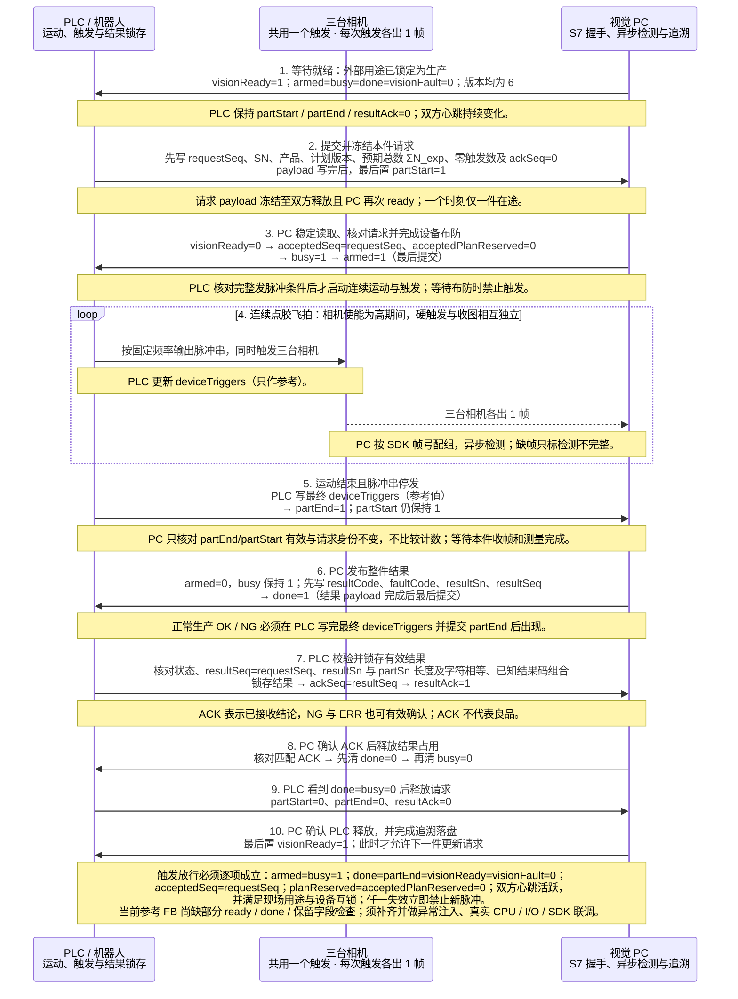
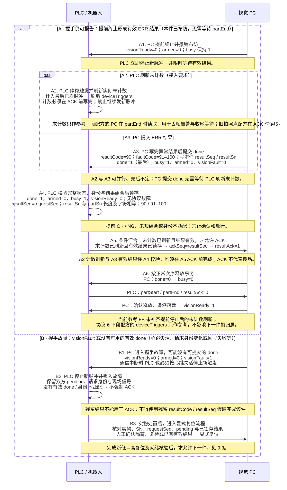

# GlueSight PLC 通讯协议

文档修订：4.1；审核日期：2026-10-23；线上握手协议版本：6。

**本修订在协议 5（《涂胶检测通信交互表 20261022 V1.1》，PLC 为 S7-1200，16 位字段统一为 Int）的点表布局上升为协议 6，对应分段连拍飞拍方案：DB4 / DB2 布局、字段名、类型、保留字节、握手顺序、心跳与复位全部不变，改变的只有计数字段的语义（第 13 节）。仓库 S7 模板（点表不变）、测试 PLC 与 PLC 参考程序随协议 6 更新；PC 握手校验以本文第 5 节为准。**

适用于 GlueSight 一期分段连拍飞拍的 PLC 与视觉工控机对接。PLC 负责机器人运动配合下的脉冲串触发，PC 负责接件、相机布防、收图、检测及整件结果回传。一件只有一个在途事务，完成结果确认和双方释放后才能开始下一件。

**三台独立相机共用一个触发。** 固定胶枪，机器人抓工件从胶嘴下走过，三台相机固定在胶嘴周围边涂边拍；PLC 发出的每个脉冲同时触发三台相机，各出 1 帧（不再是“一台设备一帧内三个视角”）。点表仍只保留一组 `deviceShots` 与 `deviceTriggers`，不设按相机的分别计数，PLC 只需一个脉冲计数；标签名沿用，含义见第 2 节。协议不接受旧多通道点表（`camera1/2/3Shots`、`camera1/2/3Triggers`）或计划，须按模板重新生成点表并重新导出计划；协议 5 的点表布局与协议 6 相同，不需要重建。现场触发模型、PLC 不参与分段、本件未检与提前终止见第 4.2 节。

**协议版本 6 与协议 5 的 DB4 / DB2 布局完全相同，不需要重新生成点表，但两者线上语义不兼容。** `protocolVersion`/`pcProtocolVersion` 由 5 升为 6；`shotCount`/`deviceShots` 由“精确计划拍照点数”改为预期总数 ΣN_exp，生产请求时核对身份，段配方的示教采集不核对；`deviceTriggers` 只作参考，结束时不再要求等于 `deviceShots`；段配方的示教采集取消 1–64 数量上限（没有段列表的旧拍照点配方，示教采集仍按协议 5，见第 4.1 节）。协议 5 的 PLC 程序（`protocolVersion` 写 5）会被 PC 在版本校验处直接拒绝，不做兼容读取；协议 4 及更早的点表与程序同样拒绝。与协议 5 的逐项差异见第 13 节，协议 5 相对协议 4 的历史差异见第 12 节，取舍理由与待 PLC 确认的问题见 [交互表适配决策 · 协议 6](../decisions/plc-table.md#协议-6-适配分段连拍) 与 [分段连拍决策记录](../decisions/segment-burst.md)。

**实现状态（2026-10-23）：协议 6 已在 PC 实现，示教采集（D1）与生产节拍和判定（C3）都已落地。旧拍照点模型只停用不删除，两类配方并存：** 配方有段列表的是**段配方**，按本文的协议 6 行为运行；没有段列表的是**旧拍照点配方**，示教采集与生产节拍的运行时规则保持协议 5 的行为，PLC 不得对旧配方依赖协议 6 的新行为。两类配方共用同一套点表与握手，线上协议版本都是 6。

- **示教采集：** 段配方候选的采集轮次取消 1–64 数量上限，不核对 `shotCount`/`deviceShots` 与计数，结束时不核对实发数、收图数、保存数相等，采集失败码为 90 配 98/99。旧拍照点配方候选的采集轮次仍同协议 5：`shotCount` 须为 1–64 且 `deviceShots` 等于 `shotCount`，不符时 PC 在布防阶段拒绝并进入视觉故障（没有 done）；PLC 须在发满 `shotCount` 个脉冲后停发，partEnd 时 `deviceTriggers`、各相机收图数与保存数都须等于 `shotCount`，缺帧、多帧、丢包均判本轮采集失败；采集失败在握手仍可报告时返回 `90/94`（相机断连、写盘超时、操作员中止也是 94）。
- **生产运行时判定：** 段配方：丢帧告警（相机帧数与 `deviceTriggers` 相差 > 1）、“检测不完整”与“帧数异常”标记、`short_part` 标记、partEnd 后整件帧组数与 ΣN_exp ± Σtol 的比较、91 仅在三台相机整件没有一帧测成时返回、不再返回 96；整条胶路按一个未分段区域判定（每帧独立检测，溢胶按每帧最大胶宽判 NG，气泡与拉丝标“未检项”，不判胶偏，也不判直线段的胶宽不均）。旧拍照点配方：缺帧（91）与多帧（96）仍按旧拍照点节拍判定，PC 不产生丢帧告警，也不产生 `short_part`。
- **两类配方共同的协议 6 行为：** 版本 6 校验；生产请求的 `shotCount`/`deviceShots` 须等于 PC 计划（段配方为 ΣN_exp，旧拍照点配方为其触发次数），否则 90/94；partEnd 不再核对 `deviceTriggers` 等于 `deviceShots`；段计划导出与计划版本规则只用于段配方。**尚未做的部分：** 多段配方的逐段分段（分段算法本轮只有“未分段”实现，各段 N_exp 可以为空，运行时只核对整件帧组数）。

**同一组 DB 也承载示教采集，线上没有生产/采集模式字段。采集成功同样返回 `1/0`，只表示采集完成，不表示产品合格。** PLC 必须在外部维护并锁定本次用途，示教期间禁止生产自动发件和良品放行；不能仅凭 ready 或 resultCode=1 判断生产模式。示教执行条件和当前限制见第 4.1 节。

本协议以仓库 S7 模板和双方握手实现为依据。PLC SCL 参考 FB 可在 S7-1200 上作为接入参考（随协议 6 更新版本号并去掉计数相等检查），仍需现场编程、真实 CPU、触发线路与相机联调验收。实现说明见 [S7 握手契约与现场接入](plc-s7-phase1.md)。

## 1 通讯参数与分工

| 项目 | 约定 |
| --- | --- |
| 连接方式 | PC 作为 S7 ISO-on-TCP 客户端，读写 PLC 共享区 |
| PLC | 西门子 S7-1200（现场已由 S7-200 SMART 更换）；CPU 订货号与固件版本现场补填 |
| PLC IP / 端口 | 默认 192.168.2.10 / 102；工控机连接 PLC 的网口须在同一网段 |
| 连接参数 | 机架 0 / 插槽 1，TSAP 按机架/插槽自动生成；PC 请求 PDU 480，以 CPU 协商结果为准。CPU 须在“防护与安全 → 连接机制”中允许来自远程对象的 PUT/GET 访问 |
| 共享区 | 两个标准 DB，均取消“优化的块访问”：DB4 为 PLC → PC，DB2 为 PC → PLC |
| 区域长度 | DB4 至少 90 字节（0–89）；DB2 至少 72 字节（0–71） |
| 数值字节序 | 大端 ABCD；Int 为 16 位有符号，本协议只使用 0–32767；DInt 为 32 位有符号，本协议只使用 0–2147483647；读到负数一律按字段越界拒绝 |
| 字符串 | 工件 SN 为 TIA `String[50]`（S7 STRING：声明长度 + 实际长度 + 字符），SN 1–50 个字符，见第 2.1 节 |
| PC 轮询周期 | 一期 S7 模板默认 50 ms；每次分两段读取 DB4 字节 0–89 与 DB2 字节 0–71 |
| 心跳 | 双方默认每 500 ms 翻转一次；观察变化，3 s 不变化判失活 |
| 自动连接 | 一期模板默认关闭；连接成功后仍必须显式复位 |
| 写入所有权 | PLC 只写 DB4；PC 只写 DB2 |

DB4 点位在 PC 点表中必须设为只读，DB2 点位设为读写。PLC 程序不得写 DB2，禁止整块清零、`FILL_BLK`/`MOVE_BLK` 等块操作覆盖 DB2；DB4 内保留字节保持 0。PC 的 50 ms 轮询不承担拍照位置或曝光时刻控制。

现场触发程序须同时满足机器人“相机使能”为高、`TriggerPermit=1` 和第 5 节的完整发脉冲条件，才向共用触发线发脉冲。该信号是参考 FB 的本地输出，不是共享区点位；当前参考程序的放行表达式缺少部分保护，见第 5 节接入限制。实际输出接线、脉冲频率、脉冲宽度、极性和运动停止策略由 PLC/机器人程序负责。

**在 TIA 中建立 DB4 / DB2：** 取消“优化的块访问”后，按第 2、3 节表格自上而下的顺序声明变量，保留位与保留字节也要声明（Bool 占位、Byte 或 Array of Byte），使编辑器“偏移量”列与表中“偏移”列逐行一致；Int、DInt、String 只能落在偶数字节，顺序或类型不同会让后续字段整体错位。建好后导出或截图偏移量列，与本表核对后再联调。

## 2 PLC 写入 PC 读取点表（DB4）

标签名称区分大小写，PC 严格握手要求每个标签只配置一次。

| 地址 | 偏移 | 类型 | 标签 | 含义及要求 |
| --- | --- | --- | --- | --- |
| DB4.DBX0.0 | 0.0 | Bool | `partStart` | 请求提交标志；payload 写完后最后置 1，保持至结果释放 |
| DB4.DBX0.1 | 0.1 | Bool | `partEnd` | 本件运动结束且脉冲串已停发；最终 deviceTriggers 写完后置 1。PC 不据此比较计数（旧拍照点配方的示教采集例外，仍核对实发数，见第 4.1 节） |
| DB4.DBX0.2 | 0.2 | Bool | `resultAck` | 结果确认标志；锁存有效结果并写 ackSeq 后置 1 |
| DB4.DBX0.3 | 0.3 | Bool | `faultReset` | 明确复位请求；必须先观察低电平，再有新上升沿 |
| DB4.DBX0.4 | 0.4 | Bool | `plcHeartbeat` | PLC 心跳，每 500 ms 翻转 |
| DB4.DBX0.5–0.7 | 0.5 | Bool ×3 | 保留 | 保持 0 |
| DB4.DBB1 | 1.0 | Byte | 保留 | 保持 0 |
| DB4.DBW2 | 2.0 | Int | `protocolVersion` | 固定 6；其他值（含 5）拒绝 |
| DB4.DBD4 | 4.0 | DInt | `requestSeq` | 本件事务序号，1–2147483647，非零且递增 |
| DB4.DBW8 | 8.0 | Int | `productCode` | 生产配方产品代码，1–32767；PC 手动选配方时也必须匹配。示教采集不据此选择候选 |
| DB4.DBW10 | 10.0 | Int | `shotCount` | 预期总数 ΣN_exp（PC 导出计划的 `expectedTotal`），0–32767。生产请求须精确等于 PC 当前计划的 ΣN_exp，否则 PC 返回 90/94；段配方的示教采集不核对，PLC 可填估算值，不再限 1–64，但参考 FB 要求大于 0（第 4.1 节）；旧拍照点配方的示教采集仍须为 1–64，且与 `deviceShots` 相等 |
| DB4.DBD12 | 12.0 | DInt | `planVersion` | 生产使用 PC 分配并导出的计划版本；示教见第 4.1 节，均不得为 0 或负数 |
| DB4.DBD16 | 16.0 | DInt | `planReserved` | 固定 0，非零拒绝处理 |
| DB4.DBW20 | 20.0 | Int | `deviceShots` | 共用触发的预期总数，与 `shotCount` 填同一值（ΣN_exp）；生产请求同样须等于 PC 当前计划的 ΣN_exp，段配方的示教不核对（旧拍照点配方的示教须等于 `shotCount`） |
| DB4.DBB22–27 | 22.0 | Byte ×6 | 保留 | 保持 0 |
| DB4.DBD28 | 28.0 | DInt | `ackSeq` | 确认时回显本件 resultSeq，新件开始前清为 0 |
| DB4.DBW32 | 32.0 | Int | `deviceTriggers` | 共用触发本件已发脉冲数，布防前为 0。只作参考与日志：结束时不要求等于 `deviceShots`（旧拍照点配方的示教采集仍须等于 `shotCount`）；段配方下与相机帧数相差 > 1 时 PC 记丢帧告警，不升级故障、不拦停 |
| DB4.DBB34–37 | 34.0 | Byte ×4 | 保留 | 保持 0 |
| DB4.DBB38.50 | 38.0 | String[50] | `partSn` | 工件 SN 字符串，占 38–89；不替代事务序号，规则见第 2.1 节 |

保留空间：DBX0.5–0.7、DBB1、DBB22–27、DBB34–37。保留字节保持 0，不定义设备通道或计数字段，不新增跨方向写入字段。

## 3 PC 写入 PLC 读取点表（DB2）

| 地址 | 偏移 | 类型 | 标签 | 含义及要求 |
| --- | --- | --- | --- | --- |
| DB2.DBX0.0 | 0.0 | Bool | `visionReady` | 可以接收下一件；连接成功不等于就绪 |
| DB2.DBX0.1 | 0.1 | Bool | `armed` | 本件相机布防完成，必须结合 acceptedSeq 判断 |
| DB2.DBX0.2 | 0.2 | Bool | `busy` | 事务处理中，包含等待结果确认阶段 |
| DB2.DBX0.3 | 0.3 | Bool | `done` | 结果有效；PC 写完结果 payload 后最后置 1 |
| DB2.DBX0.4 | 0.4 | Bool | `visionFault` | 协议或设备故障，停止新触发并处置 |
| DB2.DBX0.5 | 0.5 | Bool | `pcHeartbeat` | PC 通讯心跳，默认每 500 ms 翻转 |
| DB2.DBX0.6–0.7 | 0.6 | Bool ×2 | 保留 | PC 写 0 |
| DB2.DBB1 | 1.0 | Byte | 保留 | PC 写 0 |
| DB2.DBW2 | 2.0 | Int | `pcProtocolVersion` | 成功复位后为 6 |
| DB2.DBD4 | 4.0 | DInt | `resultSeq` | 本件结果事务序号，应等于 requestSeq |
| DB2.DBW8 | 8.0 | Int | `resultCode` | 生产整件结果或示教采集完成码，须结合外部锁定的用途，见第 6 节 |
| DB2.DBW10 | 10.0 | Int | `faultCode` | 检测异常码，正常质量结果为 0 |
| DB2.DBD12 | 12.0 | DInt | `acceptedSeq` | 已接受并布防的 requestSeq |
| DB2.DBD16 | 16.0 | DInt | `acceptedPlanReserved` | 布防时写 0，核对接受状态时应为 0 |
| DB2.DBB20.50 | 20.0 | String[50] | `resultSn` | 本件结果 SN，占 20–71；实际长度与字符须与 partSn 相等 |

保留空间：DBX0.6–0.7、DBB1。PLC 不写 DB2。`done=0` 时结果字段可能保留上件数值，不能作为新件结论。

### 2.1 工件 SN 字符串

`partSn`（`DB4.DBB38`）与 `resultSn`（`DB2.DBB20`）均为 TIA `String[50]`，各占 52 字节，PC 点表类型为 `string`：

| 字节 | 内容 |
| --- | --- |
| +0 | 声明最大长度，固定 50（0x32），由 TIA 按声明自动维护 |
| +1 | 实际长度 0–50 |
| +2 起 | 字符；未用字节 PC 写入时补 0 |

PLC 用字符串赋值或 `S_MOVE` 写 `partSn`，不要按字节拼写头字节；禁止用块操作覆盖 SN 区。

**长度字节异常不是请求 payload 不合法。** PC 每个轮询周期都读取两段 SN：声明长度不为 50 或实际长度大于 50 时，该点位读错误，与心跳、序号等字段读失败一样直接进入视觉故障（`visionFault=1`、`visionReady=0`），与是否有 `partStart` 无关。两段的恢复责任按所有者划分：

- `resultSn`（DB2）头字节异常时，PC 在显式复位中自行恢复：满足第 8 节复位条件后，PC 先把 `resultSn` 写回空串（头为 `32 00`），读回确认并记入复位审计，再继续清输出、置 `visionReady`。
- `partSn`（DB4）头字节异常时 PC 不写该区，显式复位无法完成；必须由 PLC 写回空串（头为 `32 00`），再按第 8 节复位。

PC 的自恢复只是兜底，不改变 PLC 职责：禁止整块覆盖。

SN 规则：

- 长度 1–50 个字符；每个字符为 ASCII 可打印字符 0x20–0x7E；去掉首尾空白后不能为空。
- SN 原样保存与回显，PC 不做 trim 或大小写变换。PLC 侧要求 `resultSn` 与 `partSn` 的实际长度及每个字符相等；PLC 比较时不要依赖未用字节，建议直接用字符串比较（`==`）整个字符串。
- SN 不替代 `requestSeq`；同一 SN 复检仍须新的 `requestSeq`。
- 离线产线（仿真）为每件分配形如 `OFFLINE-0001234567`（`OFFLINE-` 加 10 位数字）的 SN，同一离线运行内唯一，样本件按 SN 字符串认领。

长度字节正常但内容不合规的 `partSn`（实际长度为 0、含 0x20–0x7E 以外字符、去掉首尾空白后为空）在 PC 读取请求时判定，与其他请求 payload 不合法完全同样处理，见第 5 节。

## 4 分段计划与三相机共用触发

PC 从已发布生产配方生成计划。计划是沿胶路的**段列表**（直线段 / 弯道段，每段带预期帧数 N_exp 与容差），不再是拍照点列表。配方总览的“PLC 对接参数”面板（计划导出 JSON，可复制或另存）列出产品代码、计划版本、三台相机、段序列、各段 N_exp 与容差、整件预期总数 ΣN_exp（`expectedTotal`，即 `shotCount`/`deviceShots` 要填的值）和整件容差 Σtol（`toleranceTotal`）；PLC 工程师据此核对使能点位与脉冲频率。导出不含运动坐标或物理输出地址，运动路径由机器人/PLC 配置。

必须满足：

- `protocolVersion=pcProtocolVersion=6`。
- 生产请求的 `shotCount` 与 `deviceShots` 都等于 PC 当前计划的 ΣN_exp（非零）；不一致由 PC 在接件核对时返回 90/94。段配方的示教采集不核对这两个值（旧拍照点配方的示教仍须为 1–64 且两者相等），见第 4.1 节。
- `planVersion` 与 PC 当前计划一致（不一致 90/100）。**未标定的配方不能发布生产**：整件 ΣN_exp 由多轮采集得出之后才有可核对的计划；各段 N_exp 在分段算法就绪前允许为空（导出为 `null`），PLC 只使用 ΣN_exp。
- 计划的三台相机是三个互不相同的独立设备，共用一个触发；导出计划的 `cameras` 就是这三台设备的 id，顺序固定。请求 payload 从 `partStart=1` 起冻结，保持至本件 start/end/ACK 已清且 PC 再次 ready；下一件仅在 ready 后更新。期间只更新触发计数、结束位和 ACK。

三台相机按“一个触发、三台各出 1 帧”建模：一次触发，三台独立相机各输出一帧，不是一台设备帧内含三个视角。PC 按相机 SDK 帧号（不按到达顺序）把三台相机的帧配成帧组；某台缺帧，该组标“检测不完整”，其余相机照常判，不影响 OK/NG。PLC 的脉冲数证明输出了触发，PC 以相机实际帧为准，两者相差 > 1 记丢帧告警（第 4.2 节）。真实触发线路、三台相机各自的 Line0 接线与曝光仍须联调验收。

计划版本由 PC 配方库分配，不手工猜测或复用。改变产品代码、段序列（序号、类型）、各段预期帧数 N_exp、整件预期总数 ΣN_exp 或相机绑定会分配新版本；只改检测限值、容差、胶偏参考 x_ref、检测区间或段长沿用原版本。因此**重新标定使 N_exp 或 ΣN_exp 变化时会分配新的 planVersion，PLC 必须同步新的 `shotCount`/`deviceShots`**，PC 在界面提示。更换相机或改变设备配置必须暂停接件，核对三台相机绑定，重新导出并人工评审相机与现场触发输出的对应关系，完成复位后再生产。拍照计划不使用内容哈希匹配；旧 `planHash`、`acceptedPlanHash` 标签直接拒绝，须按新模板重建点表，`planReserved`（DB4.DBD16）与 `acceptedPlanReserved`（DB2.DBD16）固定为零值保留字段。

没有段列表的旧拍照点配方（旧模型只停用不删除）继续可用：其 `shotCount`/`deviceShots` 仍是该配方的触发次数，PC 仍按此精确核对；协议 6 对结束时不再比较计数、`deviceTriggers` 只作参考这两条对旧配方同样适用；旧配方示教采集与生产节拍的其余规则仍是协议 5 的行为，见第 4.1、4.2 节与第 13 节。

### 4.1 示教采集

1. 现场先切到示教用途并关闭自动生产请求与良品放行。确认双方上一事务已释放，PC 空闲后，由操作员在 PC 为候选草稿启动采集，使用候选配方的三台相机，PC 不手填触发数量；真实设备要求 Line0 硬触发（三台共用触发线）。PC 等待开始后，PLC 才能提交新 requestSeq，仍按第 5 节等待 armed。
2. 段配方候选的采集轮次：PLC 在开始请求中填 `shotCount`/`deviceShots`，**PC 不核对这两个值，也不再限 1–64**：PLC 可填估算值（建议填预计每轮帧数），一轮采集的帧数由实际脉冲串决定。结束时不核对 `deviceTriggers`、实际接收数与保存数是否相等：PC 按 SDK 帧号把三台相机的帧配组，记录帧组数、各相机帧数、不完整组与丢帧告警；某台缺帧只告警，不判采集失败。PC 内部的写盘队列与内存有上限，超限的帧按缺帧记录并告警，也不判采集失败。**参考 FB 要求估算值大于 0：** 参考 FB 在新件前置检查里对 `DeviceShots <= 0` 判 7004、不提交请求，PC 本身接受 0–32767，所以用参考 FB 做示教时估算值须填大于 0 的整数。这里采用“文档注明、不改 FB 判定”：生产的 ΣN_exp 恒大于 0，示教估算值本来就填预计帧数，没有填 0 的需要；放宽判定要改 PLC 程序并重新做 TIA 编译与异常注入核对，点表又没有区分示教与生产的模式字段，改了也无法只对示教放宽，收益不抵成本。旧拍照点配方候选的采集轮次仍按协议 5 处理：`shotCount` 须为 1–64 且 `deviceShots` 等于 `shotCount`，不符时布防失败并进入视觉故障（没有 done）；PLC 须在发满 `shotCount` 个脉冲后停发，partEnd 时 `deviceTriggers`、各相机收图数与保存数都须等于 `shotCount`，缺帧、多帧或丢包均判本轮采集失败，不能使用连续脉冲串。
3. 同一程序须连续采集多轮（默认 10 轮，可配）：PC 取各轮整件帧组数的均值四舍五入作预期总数 ΣN_exp，并给出容差建议；标记为标准件的轮次用于计算胶偏参考 x_ref。多轮采集不会自动发布生产配方，之后仍需示教、验证、发布并重新导出生产计划，再把导出的 ΣN_exp 填入 PLC 的 `shotCount`/`deviceShots`。
4. 当前采集路径记录 PLC 请求的非零 `planVersion` 与 `shotCount`（估算值），不与已发布生产计划比较；`productCode` 不参与候选匹配，候选来自 PC 操作员选择。因此现场须事先核对候选、三台相机、运动路径及版本并留记录；收到 armed 不证明这些业务身份已被 PC 在线核验。
5. 正常收尾：PLC 写最终 `deviceTriggers`（参考值；旧拍照点配方的采集须等于 `shotCount`）、置 partEnd，PC 等完整采集收尾窗口结束并确认已入队的帧全部保存完成后，提交 `resultCode=1/faultCode=0`。该值仅为采集完成，需锁存、ACK、释放，不计入生产 OK/NG。采集失败在握手仍可报告时，段配方的采集返回 90 配 98/99：相机断连或会话变化为 98，写盘超时、等待开始超时或操作员中止为 99；旧拍照点配方的采集一律返回 `90/94`。采集布防失败或通信故障可能直接进入 visionFault，没有 done。
6. 失败轮次不能继续补拍。处置未结事务并复位；PC 对失败的相机会话禁止再次采集，需重连该相机后整圈重采。正常完成或失败都会结束 PC 的采集占用，后续 start 可能转入生产路径；PLC 必须保持外部示教互锁，逐轮重新在 PC 启动采集。完成释放、确认 PC 无活动采集并核对生产配方/计划后，才可解除示教互锁。

**当前模式互锁缺口：** DB 和参考 FB 均没有模式确认；PC 按收到 start 时是否存在活动采集轮次分流。PC 等待开始超时或操作员取消后，迟到的 start 可能按生产请求处理。上述人工流程不能消除此竞态；现场自动示教接入前需补齐可验证的双方模式互锁，期间不得把采集完成码接到良品放行。

### 4.2 现场触发模型、本件未检与提前终止

协议 6 的运行前提是下面的**触发模型**：

- 机器人只输出一个“相机使能”DO：整条胶路只拉高一次，弯道不拉低；起头稳定后拉高、收尾前拉低。另有一个“本件未检”告知 DO。这两个信号在机器人与 PLC 之间，不在 DB4/DB2 点表内。
- PLC 在相机使能为高且满足第 5 节发脉冲条件时，以固定频率发脉冲串（按视野选定，约 10–25 Hz，相机上限 66 fps），同时触发三台相机；累计脉冲数写 `deviceTriggers`，**只作参考**。
- **PLC 不参与分段**，协议 6 不增加、不预留任何分段字段。直线段 / 弯道段由 PC 图像算法在配方预期边界附近划分；算法验证前整条胶路按“未分段”处理，只做每帧独立检测并核对整件帧组数。起头、收尾不拍，不在检测范围内，结果中标“未检区域”。

本件未检的表达方式：机器人等不到 PLC 的触发许可时，超时后照常涂胶并置“本件未检”DO。PLC 对该件不提交 `partStart`（或提前终止），PC 对该件没有请求，也就没有检测记录；整件按未检处置（隔离、复检）由现场决定。PC 看不到“本件未检”DO。

提前 partEnd（提前终止）的表达方式：PLC 在脉冲串未发完时提前置 `partEnd`，PC 不据此判故障，也不比较计数：用已收到的帧照常判 OK/NG，整件帧组数小于 ΣN_exp − Σtol 时在结果上加 `short_part`（疑似提前终止）标记，历史中单独显示（段配方；旧拍照点配方缺帧仍按旧节拍返回 90/91），**不改变 OK/NG 与 `resultCode`**。因此可能出现机器人已标“本件未检”而 PC 记录为 OK 的情况：是否按未检处置由 PLC 根据自己的“本件未检”DO 决定，不能仅凭 `resultCode=1` 放行。已布防后撤销 `partStart` 仍按握手故障处理（第 5、9.2 节）。

段配方下，PC 侧的标记与告警均只告警，不改 OK/NG（旧拍照点配方没有这些标记）：

| 标记 | 条件 |
| --- | --- |
| 检测不完整 | 某台相机缺帧（含回调丢帧、内存预算满、测量失败、胶条走出走廊）：该组按其余相机照常判，组和整件标记 |
| 丢帧告警 | 某台相机总帧数与 `deviceTriggers` 相差 > 1，或与另外每一台相机都相差 > 1（三台里只有一台对不上才算它丢帧）；≤ 1 视为正常 |
| 帧数异常 | 区域帧组数不在 N_exp ± 容差内；本阶段只比较整件帧组数与 ΣN_exp ± Σtol，各段 N_exp 为空时不逐段核对 |
| short_part | 整件帧组数 < ΣN_exp − Σtol（疑似提前终止） |

三台相机整件没有一帧测成（没有收到帧，或收到的帧都没测成）时才判不了：段配方返回 `resultCode=90`、`faultCode=91`；旧拍照点配方任一相机缺帧仍可能返回 91。

## 5 单件握手流程

| 阶段 | PLC 动作 | PC 动作与放行条件 |
| --- | --- | --- |
| 等待就绪 | 保持 start/end/ACK 为 0，确认心跳活跃 | `visionReady=1`，`armed/busy/done/visionFault=0`，协议版本为 6 |
| 提交请求 | 递增 requestSeq；写 SN（字符串）、产品代码、计划版本、预期总数 ΣN_exp 和零触发数，最后置 partStart | 稳定读取请求，核对 SN 格式、身份、配方、三台相机及计划（含 shotCount/deviceShots 等于 ΣN_exp） |
| 等待布防 | 保持请求，禁止发触发 | 先撤 ready，写 acceptedSeq 和零保留位，置 busy，最后置 armed |
| 连续运动与触发 | 核对布防条件后，在相机使能为高期间按固定频率向共用触发线发脉冲串，并更新 deviceTriggers（参考计数） | 三台相机各自收图，按 SDK 帧号配组，异步检测 |
| 提交结束 | 运动结束、脉冲串停发后，写最终 deviceTriggers，再置 partEnd；start 仍为 1。不要求等于 shotCount（旧拍照点配方的示教采集仍须等于） | 核对 partEnd/partStart 有效且请求身份未变，不比较计数；等待收尾窗口、本件收帧及测量完成 |
| 发布结果 | 等待 done，不抢先 ACK | 撤 armed，保持 busy，写结果码、异常码、SN、序号，最后置 done |
| 确认结果 | 核对并锁存结果，写 ackSeq，再置 resultAck | 核对匹配 ACK 后，先清 done，再清 busy |
| 双方释放 | 看到 done=busy=0 后，清 start/end/ACK | 确认 PLC 已释放并完成追溯落盘，再置 ready |

**请求 payload 不合法：** `requestSeq=0`、`planReserved≠0`、协议版本不符，以及 `partSn` 不合规（见第 2.1 节），均按同一方式处理：PC 不布防、不生成结果、不写 `resultCode`，进入视觉故障（`visionFault=1`、`visionReady=0`），没有可提交的 done。PLC 须释放 `partStart`，并执行故障复位（`faultReset` 上升沿，见第 8 节）后重新开始，不能等待 armed 或结果。协议 5 曾把 `deviceShots≠shotCount` 也列入此类；协议 6 不再在请求层校验 `shotCount`/`deviceShots`，生产请求中二者与 PC 计划 ΣN_exp 不一致属于接件核对，PC 返回 `resultCode=90`、`faultCode=94`，并按正常结果握手确认释放。

**发脉冲的必要条件：** `armed=1`、`busy=1`、`done=0`、`partEnd=0`、`visionReady=0`、`visionFault=0`、`acceptedSeq=requestSeq`、`planReserved=acceptedPlanReserved=0`，双方心跳活跃且现场用途、设备互锁满足，同时机器人相机使能为高。任一条件失效立即禁止新脉冲；使能为高而本条件不满足时，PLC 同样不得发脉冲。协议 6 不再以“已发数达到 `shotCount`”作为停发条件（旧拍照点配方的示教采集仍须发满 `shotCount` 个后停发）：预期总数只是核对用的名义值，脉冲串在使能期间持续发出，实际帧数允许在 N_exp ± 容差内波动。

**参考程序接入限制：** 当前 SCL 的 `AcceptedMatches` 仅核对序号，`TriggerPermit` 未完整检查 ready、done 和两处零值保留字段；PC 对非零保留字段的轮询故障不能替代 PLC 本扫描的输出互锁。现场接入须补齐上述检查并验证异常注入，不能将现有 FB 直接视为已实现完整条件。此外参考 FB 在新件前置检查里要求 `DeviceShots` 与 `PlanVersion` 大于 0，否则判 7004；示教采集的估算值也须大于 0（见第 4.1 节第 2 条）。

已发脉冲数应来自可靠输出计数源；普通扫描采样高速布尔脉冲可能漏计。参考 FB 在布防时冻结共用触发线的累计 `IssuedPulseCount` 基线，以差值写 `deviceTriggers`；累计计数在本件内不得清零、回退或回绕（回退判 7006）。`deviceTriggers` 为 Int，只用 0–32767：差值超过 32767 时参考 FB 保持 32767，不回绕为负数，也不判故障。该值只作参考：PLC 脉冲数证明输出了触发，PC 以相机 SDK 帧号为准，二者相差 > 1 只记丢帧告警。

提前撤 armed 后，PLC 还须在停止触发并计入最后已发脉冲后刷新 DB 触发数，再 ACK。段配方的 PC 在 partEnd 时读取 `deviceTriggers`，只用于丢帧告警与收尾等待（收尾等每台相机的最高帧序号达到 `deviceTriggers` − 1，或到收尾截止），没有 partEnd 的提前终止 PC 取不到该值，不等待；它不参与下一件的帧号基线（每台相机的下一件基线取本件见到的最高 SDK 帧号）。旧拍照点配方仍按协议 5：确认结果时读取实际已发触发数，用来推下一件基线。当前 SCL 在发现 armed 低时直接转等结果，未再从累计计数刷新 DB，可能遗漏前一扫描后发出的末脉冲；协议 6 下这只会使参考值偏小 1 左右，不影响段配方的帧归属，但现场仍应补齐并验证此路径。

**有效结果的必要条件：** `done=1`、`armed=0`、`busy=1`、`visionReady=0`、无协议故障，`resultSeq=requestSeq`、`resultSn` 与 `partSn` 的实际长度及字符相等，结果与异常码组合已知。正常 OK/NG 还要求 PLC 已写最终 `deviceTriggers` 并提交 partEnd（不要求其等于 `shotCount`）。

计划拒收（含 shotCount/deviceShots 与 ΣN_exp 不符的 94）或提前终止可直接返回 `resultCode=90`、`faultCode=91–100`，无需等 partEnd。等待布防时也可能收到这种结果；已布防后 armed 撤下时，PLC 停止新脉冲并限时等待结果。身份与结果组合有效后仍需锁存、ACK 和释放。提前出现 OK/NG、未知组合或身份不匹配均不得确认放行。

`resultAck` 只表示 PLC 已接收该件结论。NG 和检测异常都可以有效确认，不能把 ACK 作为良品信号。同一 SN 复检也必须使用新的 requestSeq。序号为 DInt，最大 2147483647，不能溢出成负数：到达上限前先处置未结件，在中性基线下把 requestSeq 与 ackSeq 清零并显式复位，不能直接回绕生产。PC 读到负数的 Int 或 DInt 字段按读错误进入视觉故障，读到不递增的 requestSeq 拒绝接件。PLC 对 Int 字段运算时不得写出负值。

## 6 结果与异常码

下表的质量语义仅适用于外部已锁定为生产的事务。示教采集只用 `1/0` 表示采集完成、`90` 配 `98/99` 表示可报告的采集失败（段配方；旧拍照点配方的采集失败为 `90/94`），详见第 4.1 节；线上结果本身不能区分两种用途。

| resultCode | 名称 | PLC 处理 |
| --- | --- | --- |
| 1 | OK | 合格结论 |
| 2 | OK_WITH_EXCURSION | 存在局部超差，但符合配方允许条件的合格结论 |
| 11 | NG_POSITION | 位置偏差不合格 |
| 12 | NG_ABSOLUTE | 绝对限值超差不合格 |
| 13 | NG_GAP | 断胶不合格 |
| 14 | NG_WIDTH | 胶宽超差不合格；段模型的溢胶（某帧最大胶宽超过溢胶上限）、直线段胶宽不均也用此码，原因文字区分 |
| 90 | ERR_INSPECT | 未形成有效质量判定，按 faultCode 处置 |

结果码 1、2、11–14 必须配 `faultCode=0`；90 配以下已知非零异常码。未知组合按故障处置，禁止按 OK 放行。协议 6 不新增结果码或异常码；气泡、拉丝本阶段不检，只在 PC 结果中标“未检项”，不影响结果码。

| faultCode | 含义 |
| --- | --- |
| 0 | 无检测异常，质量 NG 由 resultCode 表示 |
| 91 | 缺帧。段配方只有三台相机整件没有一帧测成（没收到帧，或收到的都没测成）才返回；单台相机缺帧只标“检测不完整”，不改 OK/NG。旧拍照点配方的缺帧判定不变（任一相机缺帧都可能返回 91） |
| 92 | 定位失败：工件位置基准无效（定位失败或胶路两端搬移超限）导致胶偏判不了；同一件另有 NG 时报该 NG，不报 92。只有旧拍照点配方的特征定位会产生，段模型不使用，保留 |
| 93 | 无效测量点 |
| 94 | 拍照计划或数量不匹配：生产请求的 `shotCount` 或 `deviceShots` 不等于 PC 当前计划的 ΣN_exp（旧拍照点配方为其触发次数） |
| 95 | 配方不可用 |
| 96 | 多余帧。协议 6 起段配方不再使用：帧数超出 N_exp ± 容差只记“帧数异常”告警；常量与本表保留，旧拍照点配方仍可能返回 96，判定不变 |
| 97 | 运动结束超时 |
| 98 | 设备丢失（含段配方示教采集时相机断连、会话变化；旧拍照点配方的示教采集失败为 94） |
| 99 | 布防或处理超时、测量执行失败等处理异常（含段配方示教采集的写盘超时、等待开始超时、操作员中止；旧拍照点配方的示教采集失败为 94），结合 PC 原因查看 |
| 100 | 计划版本、相机绑定或计划内容与 PC 不一致 |

`visionFault` 是握手层故障信号，与 `faultCode` 不同。心跳失活、请求身份变化或回写失败可能只有 visionFault 和 PC 错误原因，没有可提交的 done；此时保留未结事务，不能拿残留结果 ACK。

PLC 参考 FB 的 `LocalDiagnostic` 只在本地使用，不写 `faultCode`（DB2.DBW10）：7000 启动或未知状态需复位，7001 PC 心跳超时，7002 PC 协议故障，7003 阶段超时，7004 新件计划或前置条件错误，7005 布防或结果身份/状态不符，7006 触发计数源回退（累计脉冲计数小于布防时基线；协议 5 的“超过计划数”“结束时不等于计划数”两项判定已删除），7007 序号耗尽，7008 在途 payload 改变，7009 外部互锁故障。

## 7 心跳与时间参数

两端时间参数作用不同，现场必须一起核对，不能仅把 PLC 的等待时间写长。

| PC 生产检测设置 | 默认 | 作用 |
| --- | --- | --- |
| arm_ms | 500 ms（100–5000） | 检测布防总预算：从 PC 确认并记下 partStart 请求起，到 armed 等布防输出读回确认为止；提交前超时返回 90/99，布防回写、读回确认失败或确认时已超预算进入协议故障；布防后的握手日志落盘不计入 |
| motion_ms | 30000 ms | 等待运动结束 |
| drain_ms | 1000 ms | partEnd 后收尾收帧窗口 |
| proc_ms | 3000 ms | 等待测量完成 |
| ack_ms | 5000 ms | 等待 ACK 与释放的告警阈值 |

布防回写或读回确认失败、超时时，PC 进入 visionFault 并保留事务，不保证还有 done/99，PLC 应按故障处置。PLC 的 ArmTimeout 从 partStart↑ 计时，须覆盖 PC 开始双读确认（约 2 个轮询周期）、请求落盘、`arm_ms` 与布防落盘。两次落盘在磁盘繁忙时实测各可达约 0.65 s，合计最坏约 `arm_ms` + 1.4 s，因此 ArmTimeout 不得小于 `arm_ms` + 2 s，建议保持默认 10 s（覆盖 PC 上限 5000 ms 及上述开销）。PC 负载很高时发现 partStart 还会再滞后，不要把 ArmTimeout 压到下限。ACK 或释放等待超过 PC 阈值只告警并保持事务，不自动丢弃 done 或开始下一件。PC S7 模板心跳默认 500 ms，契约允许配置 100–1000 ms；两端失活阈值均为 3 s。

示教采集不使用生产 `arm_ms/motion_ms/proc_ms` 预算：PC 启动采集后等待 start 最长 120 s，接受 start 后重新计时，接收至 partEnd 最长 120 s。partEnd 后使用独立 `drainTimeoutMs`，默认 1000 ms、范围 200–30000 ms；即使提前收齐，也等完整窗口结束才确认完成。PLC `ResultTimeout` 必须覆盖该窗口和保存、通讯耗时，默认 10 s 不适用于例如 30 s 采集收尾。采集 ACK/释放仍使用上述 `ack_ms` 告警与事务保持规则。

| PLC 参考 FB 输入 | 默认 | 作用 |
| --- | --- | --- |
| ArmTimeout | 10 s | 等待 PC 布防；不得小于 `arm_ms` + 2 s |
| MotionTimeout | 30 s | 等待本件运动与触发结束 |
| ResultTimeout | 10 s | 等待 PC 结果，包括提前终止后的结果 |
| ReleaseTimeout | 10 s | 等待 PC 释放及下一次就绪，各阶段分别计时 |
| ResetTimeout | 10 s | 复位中性阶段与等待就绪阶段分别计时 |

PLC 阶段超时锁入故障并停止新触发，保留 pending。现场根据实际运动时间、网络与处理耗时调整双方预算，预留余量；不要把 50 ms 轮询周期当作相机触发间隔或节拍保证。

## 8 启动重连与故障复位

PC 启动、S7 重连或配置变化后要求显式复位；PLC 参考 FB 首次调用及 Startup 也进入复位态。残留 ready 高电平不证明新会话可接件，双方持久化的 pending 不因重连自动结束。

PC 写入或读取遇到断开、通讯超时或应答帧异常时，立即关闭当前 S7 连接并重新建连，不在原连接上继续收发，避免迟到应答被当成下一次请求的应答。这类读写失败因此一律按重连处理：PC 进入复位要求并撤销视觉就绪，未结事务保留，PLC 须按本节重新复位。

1. 停止新触发，核对实物、机器人动作、双方 pending、SN、requestSeq 和已锁存结果，决定隔离、复检或已有有效结果。
2. 操作员确认处置完成，再允许 `ReconcileConfirmed`。该输入不应永久接 TRUE。
3. 对参考 FB 的本地 `ResetRequest` 先置低，再发新上升沿；PLC 释放 partStart/partEnd/resultAck。运行中的未结件不能直接清输入强切下一件。
4. 保持 faultReset 为低至少 1 s，保持 requestSeq、ackSeq 基线不变，随后置 faultReset 高至少 500 ms，形成 PC 可观察的新边沿。
5. PC 在设备就绪、PLC 心跳有变化且输入中性时清输出、记录复位审计并结束原 pending，最后置 visionReady。
6. PLC 必须看到 ready 低状态后再到高状态，且 pcProtocolVersion=6、armed/busy/done/visionFault 全为 0，才认定复位成功。超时则重新处置并发新低→高复位请求。

段配方每台相机的帧归属以 SDK 帧号为准：本件帧序号 = 帧号 − 该相机基线，下一件基线 = 该相机本件见到的最高帧号，`deviceTriggers` 不参与。某台相机漏收一个脉冲时帧号不增，只影响该相机该帧（该组标“检测不完整”），不影响其他相机与下一件。持续缺帧或 `deviceTriggers` 与相机帧数持续相差 > 1 时只告警，按错误原因排查（触发线、相机取流、带宽），不自动升级为故障。

无在途事务时，设备短暂未就绪可撤 ready 并在恢复后自动就绪；PLC 遗留 end/ACK 时 PC 等待 PLC 清除。PC 输出偶发被重置可审计后恢复，60 s 内第 3 次被覆盖会故障。上述空闲恢复不替代启动、重连或心跳中断后的显式复位。

## 9 通讯时序图

以下时序图描述协议要求，条件以正文和点表为准。箭头表示写入、观察或物理触发的先后，纵向间距不代表实际耗时；硬触发不经过 PC 的 S7 轮询。

### 9.1 正常生产一件

外部用途已锁定为生产时，PLC 在相机使能期间以脉冲串同时硬触发三台相机，PC 异步收图检测；各提交标志最后写入，结果校验、锁存和 ACK 后双方释放，追溯落盘后再 ready。



### 9.2 提前终止与故障

已布防后提前终止有两种路径：握手仍可报告时形成有效 ERR 结果并按正常次序确认释放；握手故障时保留未结事务，实物处置后显式复位。检测 ERR 可有效确认，异常结论不代表质量合格。



### 9.3 启动与显式复位

启动、重连或配置变化后，先处置未结件，再建立中性基线与新复位边沿；连接成功不等于可以接件，普通空闲恢复不能代替显式复位。


## 10 分段连拍示例

以下仅用于说明数值与时序，现场必须替换成 PC 实际导出的版本和配方代码。示例计划为“直线 – 弯道 – 直线”三段，三台相机 `cam1`、`cam2`、`cam3` 共用一个触发，各段预期帧数 20、8、22，ΣN_exp 为 50，容差各为 1（Σtol 为 3）。计划导出 JSON 如下；各段 N_exp 在分段算法就绪前可以为 `null`，此时只有 `expectedTotal` 来自整件多轮采集，PLC 只使用 `expectedTotal`。

```json
{
  "protocolVersion": 6,
  "recipeId": "DEMO",
  "productCode": 7,
  "planVersion": 41,
  "cameras": ["cam1", "cam2", "cam3"],
  "segments": [
    {"index": 1, "kind": "straight", "lengthMm": 120.0, "expectedFrames": 20, "tolerance": 1, "inspectRange": {"aMm": 8.0, "bMm": 120.0}},
    {"index": 2, "kind": "corner", "lengthMm": 40.0, "expectedFrames": 8, "tolerance": 1, "inspectRange": null},
    {"index": 3, "kind": "straight", "lengthMm": 130.0, "expectedFrames": 22, "tolerance": 1, "inspectRange": {"aMm": 0.0, "bMm": 118.0}}
  ],
  "expectedTotal": 50,
  "toleranceTotal": 3
}
```

| 项目 | 示例值 |
| --- | --- |
| requestSeq / partSn / productCode | 17 / `"A24-000123"` / 7 |
| protocolVersion / planVersion / planReserved | 6 / 41 / 0 |
| shotCount / deviceShots | 50 / 50（= ΣN_exp） |
| 本件开始时 deviceTriggers | 0 |
| 布防确认 | acceptedSeq=17，armed=busy=1，ready=0 |
| 运动完成 | 相机使能拉低、脉冲串停发，deviceTriggers=51（参考值，不要求等于 50），随后 partEnd=1 |
| PC 收帧 | 三台相机各 50 帧，帧组数 50，在 50 ± 3 内；`deviceTriggers` 与各相机帧数相差 1，不告警 |
| 合格结果 | resultSeq=17，resultSn=`"A24-000123"`，resultCode=1，faultCode=0，done=1 |
| PLC 确认 | 锁存结果 → ackSeq=17 → resultAck=1 |
| 释放 | PC 清 done/busy → PLC 清 start/end/ACK → PC 再置 ready |

序号 17 写入 DB4.DBD4 的原始字节为 `00 00 00 11`；计划版本 41 写入 DB4.DBD12 为 `00 00 00 29`；shotCount=50 写入 DB4.DBW10 为 `00 32`。Int 与 DInt 均为大端，本协议只用非负值。

`partSn="A24-000123"`（10 个字符）在 DB4.DBB38 起 52 字节：

```text
DBB38  DBB39  DBB40 .......................... DBB49  DBB50 ... DBB89
32     0A     41 32 34 2D 30 30 30 31 32 33            00 x 40
```

`0x32=50` 为声明最大长度，`0x0A=10` 为实际长度，`41 32 34 2D 30 30 30 31 32 33` 是 `A24-000123` 的 ASCII，其后 40 个字节为 0。PC 回写的 `resultSn` 在 DB2.DBB20 起为同样的 52 字节（占 20–71）。空串头为 `32 00`，实际长度为 0 的空串属于不合规 SN。

## 11 实现依据与验证边界

本协议保留通信参数、点表、状态条件和参考程序限制。现场操作验收清单已按本轮测试范围删除；软件回环结果不能证明真实 CPU、I/O、SDK、节拍或实物质量。

实现依据：[交互表适配决策](../decisions/plc-table.md)、[分段连拍决策记录](../decisions/segment-burst.md)、[S7 点表模板](../../src-tauri/src/inspection.rs)、[握手校验与提交顺序](../../src-tauri/src/handshake.rs)、[PC 会话](../../src-tauri/src/plc_session.rs)、[段计划与导出](../../src-tauri/src/plan.rs)、[旧拍照点计划导出](../../src-tauri/src/plc_plan.rs)、[PC 时间设置](../../src-tauri/src/settings.rs)、[示教采集握手](../../src-tauri/src/cycle/capture.rs)、[采集状态与时间](../../src-tauri/src/recipe_capture.rs)、[设备配置](../../src-tauri/src/camera.rs)、[PLC 参考 FB](../../scripts/s7-handshake/phase1_plc.scl)。

## 12 协议 5 与协议 4、交互表 V1.1 差异

本节是协议 5 相对协议 4 的历史差异，表中“协议 5 采用”一列（含示教 1–64、唯一设备等）以协议 5 为准；协议 6 的变化见第 13 节。

对照对象：协议文档修订 2.0（握手协议 4）及当前代码中的点表模板；《涂胶检测通信交互表20261022_V1.1》中“实际 PLC 地址 / 实际对应类型”两列及现场确认（PLC 已更换为 S7-1200，16 位字段统一为 Int、地址不变）。

| 项目 | 协议 4（修订 2.0） | 交互表 V1.1 | 协议 5 采用 |
| --- | --- | --- | --- |
| PLC 型号 | S7-200 SMART | 表头仍写“200SMART” | S7-1200（现场确认已更换） |
| 连接参数 | TSAP 0x0102 / 0x0201，PDU 240 | 未给出 | 机架 0 / 插槽 1，TSAP 自动；PDU 请求 480，按 CPU 协商；须启用 PUT/GET |
| 共享区 | DB1（V 区），双方共用一个 DB | DB4：PLC → 视觉；DB2：视觉 → PLC（IP 页仍写 DB1） | DB4 / DB2，均取消优化的块访问 |
| PLC 区字段偏移 | productCode W12、shotCount W14、planVersion D16、planReserved D20、deviceShots W24、ackSeq D32、deviceTriggers W36、partSn B160 | 紧凑排列：W8、W10、D12、D16、W20、D28、W32、B38 | 按交互表 |
| PC 区字段偏移 | 位 DBX64.x，pcProtocolVersion W66、resultSeq D68、resultCode W76、faultCode W78、acceptedSeq D80、acceptedPlanReserved D84、resultSn B100 | 从 0 起：位 DBX0.x，W2、D4、W8、W10、D12、D16、B20 | 按交互表 |
| 其余字段 | partStart 等 Bool 位、protocolVersion W2、requestSeq D4 | 偏移不变，改在 DB4 | 按交互表 |
| 16 位字段类型 | WORD，0–65535 | UINT 与 INT 混写 | Int，只用 0–32767，负数拒绝（现场确认统一 Int，地址不变） |
| `productCode` 范围 | 1–65535 | 未说明 | 1–32767 |
| `shotCount` 范围 | 1–65535（示教 1–64） | 备注写 1–65535 | 1–32767（示教 1–64） |
| 32 位字段类型 | DInt，0–2147483647 | DInt | 不变 |
| `protocolVersion` / `pcProtocolVersion` | 4 | 备注仍写“固定 2”“复位后为 2” | 5 |
| `partSn` | DBB160.50，默认 200 SMART 字符串，可选 S7 STRING | DB4.DBB38，string，未给长度；备注仍写“数值 SN，不是字符串条码” | DB4.DBB38，`String[50]`，占 38–89；字符串条码，旧备注作废 |
| `resultSn` | DBB100.50，与 `partSn` 同编码 | DB2.DBB20，`STRING[50]` | DB2.DBB20，`String[50]`，占 20–71 |
| SN 编码与长度 | 200 SMART 字符串 1–49 字符；S7 STRING 1–50 字符 | 未说明 | 只用 S7 STRING，1–50 字符 |
| `resultCode` / `faultCode` | DBW76 / DBW78，WORD | DB2.DBW8 / DB2.DBW10，UINT（V1.0 的 DBD 笔误已改正） | DB2.DBW8 / DB2.DBW10，Int |
| PLC 区保留 | DBX0.5–0.7、DBB1、DBB8–11、DBB26–31、DBB38–63 | DBX0.5–0.7、DBB1、DBB22–27、DBB34–37（“BTYE”应为 BYTE） | 按交互表 |
| PC 区保留 | DBX64.6–64.7、DBB65、DBB72–75、DBB88–99、DBB152–159 | DBX0.6–0.7、DBB1 | 按交互表 |
| 写入所有权 | 同一 DB 内按字节划分：PLC 0–63 与 160–210，PC 64–150 | 按两个 DB 划分 | PLC 只写 DB4，PC 只写 DB2 |
| 最小区域长度 | 211 字节（S7 STRING 为 212） | 未说明 | DB4 90 字节；DB2 72 字节 |
| PC 每次轮询读取 | 字节 0–37 与 64–210 两段 | — | DB4 0–89 与 DB2 0–71 两段 |
| PLC 参考程序 | SCL 仅作 200 SMART 逻辑参考 | — | SCL 可在 S7-1200 上直接作参考 FB，随本协议更新布局 |
| IP 汇总 | 仅 PLC 一行 | 仅 PLC 一行 | 待现场补齐 CPU 订货号、固件及其余网口 |

**协议版本升为 5 的理由：** 版本号用于识别线上布局。S7-1200 的 DB 号可以任意填写，若沿用 4，用协议 4 模板生成、只把 DB 号改成 4 的点表会读到 `protocolVersion=4` 而通过校验，随后 `productCode`、`shotCount` 等按旧偏移读出错位数值，表现为难以定位的计划或身份不符；升为 5 后在版本校验处直接报“PLC 协议版本 x 与 PC 5 不一致”。16 位字段由无符号改为有符号、SN 只保留 S7 STRING，也属于线上语义变化。PLC 只需把 `protocolVersion` 写为 5。

## 13 协议 6 与协议 5 差异

对照对象：本文档修订 3.0（握手协议 5）；协议 6 依据分段连拍飞拍方案（规格第 18 版）与实现决策。DB4 / DB2 布局、点表模板、字段名与类型、保留字节、握手顺序、心跳、复位与 SN 规则均不变。

| 项目 | 协议 5 | 协议 6 采用 |
| --- | --- | --- |
| `protocolVersion` / `pcProtocolVersion` | 5 | 6，其他值（含 5）拒绝 |
| 点表与 DB 布局 | DB4 90 字节、DB2 72 字节，28 个字段 | 不变；点表模板不变，不需要重新生成点表 |
| 设备模型 | 唯一三目设备，一次触发一个设备帧，帧内三个视角，称“设备通道 1” | 三台独立相机共用一个触发，一次触发各出 1 帧；PLC 仍只需一个计数 |
| 计划形态 | 拍照点列表（shotId、poseId、cameraId、view） | 段列表（直线 / 弯道，各段 N_exp 与容差）、三台相机、ΣN_exp、Σtol；计划导出 JSON 见第 10 节 |
| `shotCount` / `deviceShots` | 精确的计划拍照点数，必须相等且非零，结束时 `deviceTriggers` 必须等于它 | 预期总数 ΣN_exp；生产请求须精确等于 PC 计划，否则 90/94；段配方的示教不核对，PLC 可填估算值（参考 FB 要求大于 0）；请求层不再校验非零与相等 |
| `deviceTriggers` | 结束时必须等于 `deviceShots` | 只作参考与日志，不要求等于 `deviceShots`（旧拍照点配方的示教采集仍核对）；段配方下与相机帧数相差 > 1 记丢帧告警，不升级故障、不拦停 |
| `partEnd` | PLC 核对实发数等于计划数后才置；PC 校验计数相等 | 运动结束、脉冲串停发后置；PC 只核对 partEnd/partStart 有效与请求身份不变；结束后用整件帧组数与 ΣN_exp ± Σtol 比较，越界只告警（段配方） |
| 示教采集数量 | PLC 提供 1–64，实发数、收图数、保存数须全部等于它 | 段配方：无 1–64 上限，不核对计数，PLC 可填估算值（参考 FB 要求大于 0）；采集失败码为 90 配 98/99（原 90/94）。旧拍照点配方的采集仍按协议 5 |
| 帧归属 | 按触发计数减基线对应拍照点 | 段配方：帧序号取相机 SDK 帧号并按帧号配组，不按到达顺序数；下一件基线取每台相机本件见到的最高帧号。旧拍照点配方的按触发计数路由与基线规则不变 |
| 缺帧 / 多帧 | 缺帧 91、多帧或超计划 96 | 单台缺帧只标“检测不完整”，不改 OK/NG；帧数越界只告警；96 不再使用；91 仅在三台相机整件没有一帧测成时返回（段配方；旧拍照点配方不变） |
| 提前 partEnd | 计数不等判故障 | 用已收到的帧照常判，整件帧组数 < ΣN_exp − Σtol 加 `short_part` 标记，不改 OK/NG（第 4.2 节；段配方） |
| 本件未检 | — | 机器人置“本件未检”DO，PLC 不提交 `partStart`（或提前终止）；PC 无记录（第 4.2 节） |
| 计划版本身份 | 产品代码 + 拍照点 id / Pose / 相机序列 | 产品代码 + 各段（序号、类型、N_exp）+ 有序相机 + ΣN_exp；N_exp 或 ΣN_exp 变化即新版本，PLC 须同步 `shotCount`/`deviceShots` |
| 结果码 | 1、2、11–14、90 | 不新增；溢胶与胶宽不均判 14，气泡与拉丝本阶段不检 |
| SCL 参考 FB | 运动中已发数超过计划、结束时不等于计划都判 7006 | 两处删除；累计计数回退仍判 7006；`deviceTriggers` 超 32767 时饱和 |

**协议版本升为 6 的理由：** 点表布局没有变，但 `shotCount`、`deviceShots`、`deviceTriggers` 的含义和结束条件变了。若沿用 5，按协议 5 编写的 PLC 程序会在连续脉冲串下按“已发数达到计划数”停发或判 7006，现场表现为难以定位的缺帧或计数故障；升为 6 后在版本校验处直接报“PLC 协议版本 5 与 PC 6 不一致”。PLC 只需把 `protocolVersion` 写为 6，并按本协议改写计数相关逻辑；现场 PLC 草稿 `scripts/s7-handshake/site/gluesight_site.scl` 需要的改动点见该目录 README 的“协议 6 需要的改动点”。
