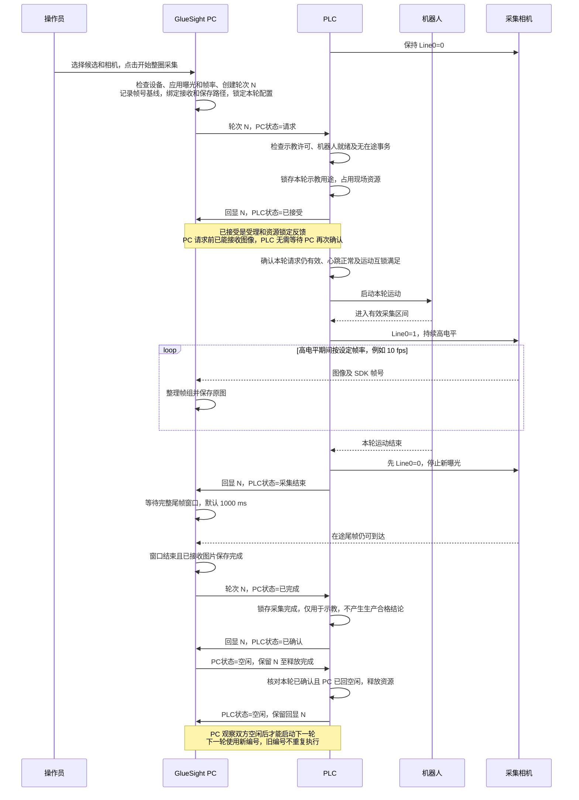

# 整圈示教采集接口 V1：PC 发起启动

本文是 PC / PLC 双方的整圈示教采集接口规格。一次点击采集一轮，采用“一个轮次编号＋双方状态”，不自动重试或连续排队。

生产握手为[生产通讯协议 7](plc-communication-protocol.md)（DB4 / DB2，状态字握手）。示教使用独立扩展协议 V1 和 DB6 / DB12，不叠加生产的 plcState / pcState，也不另分配 PLC 事务编号；与生产的互斥见第 5 节。

## 1. DB 分配与数据类型

第一版分配 **DB6：PC → PLC**，**DB12：PLC → PC**，每块 **10 字节**。现场已确认 DB6 / DB12 可用；部署时仍应核对工程中未被新增功能占用；若冲突，双方统一修改整块 DB 编号，保持内部偏移一致，更新文档后再实施。不得覆盖现场已有 DB。

两个 DB 均取消“优化的块访问”，采用标准绝对地址、大端字节序。PC 只写 DB6，PLC 只写 DB12；禁止跨方向写入或整块清零对方区域。PC 点表将 DB6 配为读写、DB12 配为只读。

PC 点表另设只读 `teachPlcSnapshot`（`DB12.DBB0.10`，Bytes），一次读取 DB12 完整快照；这是同一数据区的读取别名，不增加 PLC 字段或空间。PLC 工程把 `teach_plc` 分配为 DB12；软件启动时把带示教标签、地址仍是旧默认 DB8 的点位迁到 DB12，不改其他 DB8 点位。

### DB6：PC 写，PLC 读

| 地址 | 类型 | 名称 | 定义 |
| --- | --- | --- | --- |
| DB6.DBW0 | Int | teachPcVersion | 固定 1；0 表示本端尚未初始化 |
| DB6.DBW2 | Int | teachPcState | PC 状态，见第 2 节 |
| DB6.DBW4 | Int | teachRoundId | 轮次编号 N，范围 1–32767；初始无历史轮次为 0 |
| DB6.DBW6 | Int | teachPcReason | 原因码；正常为 0 |
| DB6.DBW8 | Int | teachPcReserved | 固定 0 |

### DB12：PLC 写，PC 读

| 地址 | 类型 | 名称 | 定义 |
| --- | --- | --- | --- |
| DB12.DBW0 | Int | teachPlcVersion | 固定 1；0 表示本端尚未初始化 |
| DB12.DBW2 | Int | teachPlcState | PLC 状态，见第 2 节 |
| DB12.DBW4 | Int | teachRoundIdEcho | 回显同一个 N（1–32767），初始为 0，不分配第二个事务编号 |
| DB12.DBW6 | Int | teachPlcReason | 原因码；正常为 0 |
| DB12.DBW8 | Int | teachPlcReserved | 固定 0 |

TIA 声明顺序为五个 Int，偏移分别为 0、2、4、6、8。状态是一个 Int 枚举，不是位掩码。轮次编号 0 仅用于初始化，不能发起请求；负值一律非法。

### 更新与读取规则

1. 先写版本、编号、原因和保留字段，全部成功后最后单独发布状态；发布后保持内容稳定至下一个合法状态迁移。
2. PC 对 DB12 连续取得两份一致的完整快照后处理状态；PLC 对 DB6 在连续两个扫描周期取得一致快照后处理状态。一次快照只复制一次本端读取缓冲，禁止拼接不同扫描周期的字段。
3. 空闲阶段不处理暂存中的新编号。仅在合法非空闲状态、版本为 1、保留值为 0、编号匹配时执行对应动作。状态不能依赖短脉冲，不能在接收方未响应时跳过必需步骤。原因在状态发布前可能已更新；同编号、同状态的重复快照沿用已消费的原因，不把暂存中的下一状态原因误判为故障；消费新状态时再核验原因组合。活动期间编号变化仍必须立即停止门控。
4. PC 持久化已分配的最大编号，发请求前完成落盘；PLC 保持已处理的最大编号和未结状态。下轮 N 大于双方已知最大值，不复用拒绝、取消或失败轮次编号。达到 32767 后停止申请，维护时协同迁移，禁止自动回绕。
5. 正常回空闲后保留最后编号，原因清 0。保留数据丢失、重启或连接重建须显式核对复位，不能凭残留“请求”自动执行。PC 不因超时自行生成新编号重发。

## 2. 状态及原因编码

| PC 状态值 | 名称 | 含义 |
| --- | --- | --- |
| 0 | 空闲 | 无正在发起的示教事务 |
| 10 | 请求 | 相机、图像接收和保存均已准备好；保持至完成、失败或取消 |
| 20 | 已完成 | 收到本轮采集结束，尾帧窗口结束且原图保存完成 |
| 30 | 失败 | PC 无法完成本轮采集，原因非 0 |
| 40 | 取消 | 操作员或等待超时要求取消，原因非 0 |

| PLC 状态值 | 名称 | 含义 |
| --- | --- | --- |
| 0 | 空闲 | 无示教资源占用；不单独代表现场允许运动 |
| 10 | 已接受 | 已锁存本轮用途及资源；互锁满足即可执行，无需 PC 再确认 |
| 20 | 采集结束 | Line0 已拉低、本轮运动已结束，等待 PC 保存结果 |
| 30 | 已确认 | 已锁存 PC 完成、失败或取消结果，门控为低、运动已处置 |
| 40 | 已拒绝 | 未启动本轮，给出拒绝原因 |
| 50 | 故障 | 需要处置及显式复位，不自动回空闲 |

PC 原因：0 无；1 操作员取消；2 等待接受超时取消；3 相机故障或会话变化；4 保存失败；5 收尾处理超时；6 协议或通讯异常；7 等待采集结束超时。

PLC 原因：0 无；1 示教未许可；2 机器人未就绪；3 生产或其他事务占用；4 现场互锁不满足；5 协议或状态非法；6 PC 心跳失活；7 运动超时；8 等待 PC 结果超时；9 现场执行故障；10 等待释放超时。

PLC 40 配原因 1–5，PLC 50 配原因 4–10；PC 30 配原因 3–7，PC 40 配原因 1–2。其他正常状态原因必须为 0。未知状态、未知原因组合、活动期间编号变化或版本不匹配禁止启动或继续门控，按协议异常处置。不得将示教状态映射成生产 OK / NG。

## 3. 正常一轮时序

前提：双方心跳正常，必要复位已完成，无未结事务，双方示教状态均为空闲；PLC 现场示教许可有效。相机使用 Line0 高电平模式，PLC 负责运动互锁和门控输出。

PC“请求”同时承诺本轮已准备好，可以执行。PLC“已接受”用于反馈受理和资源锁定；现场条件满足时即可启动运动，无需 PC 再确认，也不等待 PC 界面显示接受状态。PC 按同一编号核对反馈，但不能把收到“已接受”作为开始接收图像的条件。

PC 从发出请求起保持接收能力并锁定本轮配置，禁止修改参数或释放相机；请求状态保持至完成、失败或取消等后续状态。等待超时不能自行退回空闲或关闭接收，须走取消或故障流程，直到明确拒绝、完成或取消确认后按释放顺序结束。设备故障、心跳失活或请求失效时，PLC 不得启动或继续门控，运动由 PLC 处置。

PLC 已拉低但尚未报告“采集结束”时，PC 不能自行把本轮判为完成。帧数由实际接收决定，不按预估数量提前结束。

## 4. 拒绝、失败与取消

| 情况 | 处理原则 |
| --- | --- |
| PC 准备失败 | 不发请求，页面说明原因 |
| PLC 拒绝请求 | 回显 N，置“已拒绝”及原因；不运动、Line0 保持低。PC 记录拒绝后回空闲，PLC 观察到本轮 PC 空闲后回空闲 |
| PC 保存失败 | PC 报“失败”及原因；PLC 在门控已低、运动已处置后回“已确认”，再按双方回空闲顺序释放。确认不代表采集成功 |
| 操作员取消 | PC 保持 N 并报“取消”；PLC 停止门控，处置运动后回“已确认”，双方再回空闲。取消不是 PC 直接停止机器人 |
| PLC 现场故障 | 立即拉低 Line0，报告“故障”及原因；不自动回空闲或启动下一轮，处置未结轮次并复位 |
| 心跳失活或通讯中断 | PLC 拉低 Line0，双方保留未结轮次；恢复通讯不自动重跑旧请求，先核对并复位 |

重复的同编号请求只保持已有处理状态，不再次启动机器人。PLC 对同编号取消 / 失败优先于启动运动处理；如果还未接受，只需确认本轮未运动、门控为低即可返回已确认。若取消到达前已启动，则处置运动后再确认。PLC 已拒绝时收到同编号取消仍保持已拒绝，PC 将已拒绝视为明确未执行并回空闲。

PC 只能在本轮 PLC 已确认或已拒绝后正常回空闲；PLC 只能在上述状态看到同编号 PC 空闲后回空闲。PC 已完成只允许在 PLC 采集结束后提交；PLC 仅在采集结束状态接受 PC 已完成。PLC 已确认并不等同于采集成功，必须先锁存 PC 的终态和原因。

PLC 已接受不要求 PC 观察到该中间状态后才运动，因此 PC 可能直接读到同编号“采集结束”；PC 在请求阶段允许接受该终止采集通知并收尾，不得因此判为错序。PC 未确认释放前不得重启本轮或接受下一轮。

## 5. 互锁、超时与复位

- 沿用 DB2.pcHeartbeat 和 DB4.plcHeartbeat，默认每 500 ms 翻转，3 s 无变化失活；示教状态轮询建议 50 ms。PLC 在启动运动前及采集期间持续核对心跳、匹配编号、PC 状态=10、现场许可和机器人互锁。
- PLC 本地示教许可独立于 PC 请求。新示教与新生产请求同时到达时，第一版优先生产、拒绝示教（原因 3）；已经受理的示教保持独占，生产请求不得插入。PC 同样禁止活动示教期间进入生产处理。生产的 PC 就绪（pcState=10）只按生产协议解释，不作为本接口的示教接受信号。
- Line0 仅在本轮 PLC 已接受、PC 请求有效、有效采集区间为高且互锁满足时为高。结束、取消、失败、故障或心跳失活立即拉低；机器人停止或安全退出由 PLC 现场逻辑负责。
- 建议初始预算：PC 等待接受 10 s，超时转取消而不是空闲；PLC 运动 120 s；PC 尾帧窗口 1000 ms，保存收尾总预算 10 s；PLC 等待 PC 结果 15 s；双方等待取消确认或释放 10 s。现场可调整，但 PLC 等待结果必须大于 PC 尾帧及保存预算并留通讯余量。已接受后 PC 等待采集结束上限建议 130 s。
- 未能按时取消、故障、通讯恢复或启动重连后，保留轮次记录，禁止自动执行。复用生产复位（操作员软件复位，或 PLC 置 plcState=99）与人工处置确认流程：先停止门控、处置运动和未结轮次，双方将各自示教状态恢复空闲并保留编号高水位；基础复位完成且双方版本正确、示教状态为空闲后才允许新请求。PLC 的复位条件必须覆盖示教，不能忽略示教未结事务。
- 原因 5 等协议异常下若无法可信关联当前请求，PLC 保留已锁存编号并置故障，不回显可疑编号，不对未知轮次发已确认。PC 检测到不匹配或无法通信时进入本地故障，不把写入失败的状态当成已经通知 PLC。

## 6. 双方分工与验收

PC 实现：持久化轮次编号、准备后发请求、接收不等待确认、状态读取校验、尾帧收尾及保存、取消与故障展示、生产互斥。

联调入口：PLC 通讯页“示教流程”TAB 独立展示双方示教状态、轮次与回显、原因码及当前等待环节，DB6 / DB12 点位归入“示教点位”，与工件握手分开；连接配置、心跳和共用复位监视常驻。监视只读，开始与取消仍在配方整圈采集页。PC 字段仅在成功发布并回读后显示，PLC 字段采用后台确认的完整快照；尚未确认、断线或读取失败时显示不可用，不能把本地拟写值或上一次有效观测当作当前值。PLC 寄存器不合规时，监视按协议指出具体项（版本、保留、未知状态、非空闲未回显轮次、原因码与状态不符）并标红，报错带 DB12 五个实际值。复位期间 PLC 尚未回到合规空闲时不立即判故障，显示等待原因，15 s 内 PLC 处置完成即自动完成复位，超时再报故障。PC 等待接受（或接受前取消）期间读到 PLC“已接受”但握手编号回显为 0 时，视为 PLC 尚未发布完，继续等待：回显与本轮编号一致才算接受，10 s 接受超时后按原因 2 取消，取消确认再超时才报故障。接受之后回显为 0 仍按违规处理。PLC 仍应在同一扫描周期内先写回显、最后写状态。

PLC 实现：创建 DB6 / DB12、受理和去重、生产互斥、现场许可、轨迹执行和门控、结果确认、保留未结轮次及复位联动。

第一版不下发机器人轨迹号、产品代码、SN 或预计帧数：PC 记录本地候选和轮次，PLC 使用现场已选定的示教轨迹。启动前操作员核对两端产品与轨迹一致；当前接口不自动验证此一致性。有效采集区间必须排除接近和回程。

联调至少覆盖：正常一轮；未许可拒绝；相同请求重复读取只运动一次；接受前及运动中取消；取消与接受交错；保存失败；运动 / 结果超时；心跳中断；双方任一端重启不重跑；释放未完成禁止下一轮；示教不输出生产良品；2 秒 / 5 秒高电平约 20 / 50 帧及拉低停止新曝光。尾帧到达不等同于拉低后新曝光。

JHEM131GC-XS 的 `FrameBurstStart + LevelHigh` 已实测：高电平期间按设定 10 FPS 连续采集，拉低后停止新曝光。这两项门控能力已验收；示教握手、运动互锁及异常停止仍按上述联调清单验收。

交付前由 PLC 工程师确认 DB6 / DB12 可用、TIA 偏移和保持性配置、示教许可及采集区间接线、轨迹选择和超时预算。
